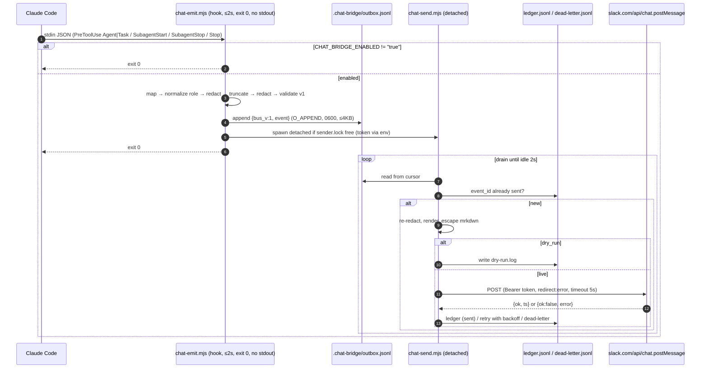
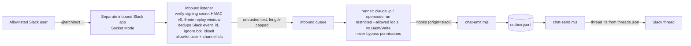

# ADR-0003: Team Chat Bridge (agent activity to Slack, then Discord and inbound)

- **Status:** accepted
- **Date:** 2026-11-11
- **Deciders:** Architect; consulted Security (F1 redaction and secret boundaries); PM (scope as approved by the user)
- **Related:** US-002 (this ADR), US-003 (`integrations/chat/schema/event.v1.schema.json`), `STANDARDS.md` §1/§4/§5, `.claude/settings.json`, `opencode.json`, ADR-0001

## Context

The user wants the agent team's activity posted to a **real Slack workspace**, with
each agent shown under its own identity (username and icon through
`chat:write.customize`). The work is split into three phases:

| Phase | Scope | Risk |
|-------|-------|------|
| **F1** | Slack outbound only, emitted from Claude Code hooks | low |
| **F2** | Discord adapter, OpenCode plugin emitter, Slack threads per run, mentions | medium |
| **F3** | Inbound: `@agent` in Slack starts a headless `claude -p` / `opencode run` | **high** |

The user approved these decisions:
- Slack first, with Node as the runtime.
- Work summaries may be published, but only redacted. Diffs are never published.
- Default verbosity is handoffs, `agent.started`/`agent.finished` and gate results. Nothing else.
- The bridge is opt-in through `CHAT_BRIDGE_ENABLED`.
- Hooks never block: each one finishes in 2 s or less and always exits 0.

Hard constraints:
- `agents/*.md` is never modified.
- `.claude/settings.json` and `opencode.json` only receive additive changes.
- Secrets live only in `.env`.
- New code goes under `integrations/chat/`.

The repo has no Node project yet. `ci.yml` is a generic Node template (Node 20, `npm run lint`, `npm test`, `npm audit`). Node 20 reached end of life in April 2026.

Claude Code hook facts this design relies on:
- Hooks receive JSON on stdin with `session_id`, `transcript_path`, `cwd` and `hook_event_name`.
- `PreToolUse` adds `tool_name`, `tool_input` and `tool_use_id`. The subagent tool is named `Agent` in current versions and `Task` in older ones.
- `SubagentStart` and `SubagentStop` carry `agent_id` and `agent_type`. `SubagentStop` also carries `agent_transcript_path` and `last_assistant_message` where the installed version provides it.
- `Stop` fires at the end of every main-session turn.
- **Hook stdout is parsed by Claude Code**. A `PreToolUse` hook can return permission decisions, and a `Stop` hook can return `decision: "block"`. A bridge hook must therefore never write to stdout.

## Decision

We will build a **zero-runtime-dependency Node ≥ 22 bridge** under `integrations/chat/`. It works in two steps:

1. A **synchronous emitter**, run by the hooks, maps each hook payload to a redacted `event.v1` record and appends it to a **local spool file**. It then starts a **detached sender** and exits 0.
2. The sender drains the spool, deduplicates by `event_id` against a ledger, and posts through a pluggable **adapter**. Slack is the only adapter in F1. It calls `chat.postMessage` with native `fetch`.

### D1. Runtime and dependency policy
- **Node ≥ 22 LTS**: `engines.node: ">=22"`. CI runs on Node 24, the Active LTS release. The template's `node-version: 20` must be raised for this package (follow-up for DevOps).
- **Runtime dependencies: zero.** The bridge uses only built-ins:
  - global `fetch`
  - `AbortSignal.timeout`
  - `crypto.randomUUID` and `crypto.createHash`
  - `node:fs`, `node:child_process`, `node:test`
- **Slack Web API is called with `fetch`, not `@slack/web-api`.** F1 needs exactly one method, `chat.postMessage`. Reasons for skipping the SDK:
  - it would add a dependency tree that falls under the `npm audit` gate;
  - it slows cold start inside a 2 s hook budget;
  - it has its own retry and logging behaviour, which makes "never log the token" harder to guarantee.
- **devDependencies are allowed and kept minimal**: `ajv` and `ajv-formats` (contract tests), `eslint` and `@eslint/js` (lint gate). Any other dependency needs an amendment to this ADR.
- Package layout: `integrations/chat/package.json` with `"private": true` and `"type": "module"`. Files use the `.mjs` extension and kebab-case names (`STANDARDS.md` §3).

### D2. Transport: spool file plus detached sender (async delivery, sync enqueue)
- **Enqueue happens inside the hook and is synchronous.** It does one `appendFileSync` of one JSONL line. The spool directory is `<project>/.chat-bridge/`, or `CHAT_BRIDGE_SPOOL_DIR` if set. The path is platform-neutral so the OpenCode plugin can share it in F2. **Follow-up:** add `.chat-bridge/` to `.gitignore`.
- **Delivery is asynchronous.** After appending, the emitter checks `sender.lock`. If the lock is missing or stale (dead pid), the emitter starts the sender with `spawn(process.execPath, [send.mjs], {detached: true, stdio: 'ignore', env}).unref()`. Rules for the spawn:
  - the token is passed through `env`, never through argv;
  - the hook never waits for the network.
- **Sender behaviour:**
  - It takes the lock (`O_EXCL`), reads the spool from the offset in `cursor.json`, posts, and writes to the ledger.
  - It exits when the spool is idle for 2 s.
  - Concurrent hooks that find the lock held only append to the spool.
- **Hook budget:**
  - The hook entry `bin/chat-emit.mjs` wraps everything in `try/catch` and has a 1500 ms internal deadline. It always exits 0 and writes **nothing** to stdout. Diagnostics go to `.chat-bridge/bridge.log` (0600).
  - In `settings.json`, `timeout: 2` is the outer guard.
  - When `CHAT_BRIDGE_ENABLED` is not `"true"`, the hook exits 0 before reading config. Cost is one env check.

### D3. Bus record format (emitter → sender contract)
Each spool line is one JSON object, at most 4096 bytes so that `O_APPEND` writes stay atomic:
```json
{"bus_v":1,"enqueued_at":"2026-11-11T14:03:22.130Z","event":{ /* event.v1 */ }}
```
- The `bus_v` envelope lets the transport evolve without touching the event contract. A line over 4 KB is re-truncated by the emitter (summary first). If it is still too large, the summary is dropped and `redaction.summary_dropped=true` is set.
- The sender treats every line as untrusted:
  - it caps line size, `JSON.parse`s inside `try`, and validates against `event.v1`;
  - it dead-letters invalid lines, lines with an unknown `bus_v` and lines with an unknown `schema_version`.
- Files in `.chat-bridge/` (directory 0700, files 0600, opened with `O_NOFOLLOW` after an `lstat` check that rejects symlinks):

| File | Purpose |
|------|---------|
| `outbox.jsonl` | append-only spool, capped at 5 MB, rotated after full drain |
| `cursor.json` | `{offset, inode}` read position |
| `ledger.jsonl` | `{event_id, status:"sent", provider, channel, message_ref, sent_at}` (idempotency ledger) |
| `dead-letter.jsonl` | `{event_id?, reason, error_code, attempts, failed_at, line?}`, 7-day TTL |
| `threads.json` | F2 only: `{correlation_id: {provider, channel, thread_ref, created_at}}` |
| `sender.lock` | `{pid, started_at}` |
| `bridge.log` / `dry-run.log` | diagnostics and dry-run rendered payloads |

### D4. Idempotency
- **`event_id` is deterministic**: a UUID-formatted value made from `sha256(fingerprint)`, with version nibble 8 and RFC 4122 variant. Fingerprints:

| Event type | Fingerprint |
|------------|-------------|
| `handoff` | `session_id · "handoff" · tool_use_id` |
| `agent.started` / `agent.finished` | `session_id · type · agent_id` |
| `gate.result` | `session_id · gate · story_id/release · raw_verdict · counts`. The receipt is the identity, so the same receipt seen in `SubagentStop` and again in the PM's `Stop` collapses to one event. |

- `correlation_id` is the hashed root `session_id`. `span_id` is the hashed `tool_use_id`/`agent_id`. Raw native ids never leave the machine.
- **Delivery is at-least-once.** The sender skips any `event_id` already in the ledger. Slack's `chat.postMessage` has no idempotency key, so a crash between a successful POST and the ledger write can produce one duplicate. We accept that.

### D5. Hook → event mapping (Claude Code, F1)
Additive `hooks` block in `.claude/settings.json`. Every command is `node "$CLAUDE_PROJECT_DIR/integrations/chat/bin/chat-emit.mjs"` with `timeout: 2`:

| Hook (matcher) | Emitted event(s) | actor | data / summary |
|---|---|---|---|
| `PreToolUse` (`Agent\|Task`) | `handoff` | the calling agent (`agent_type` if the hook fires inside a subagent, else `pm`) | `to` = normalized `tool_input.subagent_type`; `task_title` = redacted `tool_input.description`. **`tool_input.prompt` and all other fields are dropped.** |
| `SubagentStart` | `agent.started` | normalized `agent_type` | `parent` when known |
| `SubagentStop` | `agent.finished`, plus 0..n `gate.result` | normalized `agent_type` | `outcome`; summary = redacted `last_assistant_message` (fallback: last assistant text in the tail of `agent_transcript_path`, max 64 KB read); gate detector runs on the same text |
| `Stop` (main session) | 0..n `gate.result` only | owner role of the receipt (see D6) | gate detector on the main last message; dedup via D4 |

- **Role normalization:** `identities.aliases`, then `identities.roles`, otherwise `"unknown"`. Raw input is never used as a username.
- `Stop` does **not** emit `agent.finished` for `pm` at default verbosity, because it fires on every turn. At `verbosity: "verbose"` it emits `agent.finished` with `actor: "pm"`.
- **F2 (OpenCode):** an additive plugin under `integrations/chat/opencode/` maps OpenCode session and tool events to the same `event.v1` with `source.platform="opencode"`. The mapping table will be signed in a later ADR amendment.

### D6. Gate detection
- **Gate results are found by parsing the receipt formats fixed in `STANDARDS.md`.** No heuristics are applied to free text. A pure function `detect-gates(text) → GateResult[]` uses anchored, line-based regexes. It accepts `Veredicto:` or `Verdict:` and Spanish or English labels:

| Receipt header | gate | Parsed | owner role |
|---|---|---|---|
| `REVIEW RECEIPT` | `review` | `Findings: 🔴 N \| 🟡 N \| 🟢 N` → counts; `Veredicto: APPROVED\|CHANGES REQUESTED` | `cavecrew-reviewer` |
| `DoD — <story-id>` | `dod` | `RESULTADO: DONE\|NOT DONE`; story id from header | `qa` |
| `SECURITY RECEIPT` | `security` | `Release:`, `Dependency audit: N high / N critical`, `Veredicto: APPROVED\|BLOCKED` | `security` |

- Normalized verdict: `pass` ⇐ APPROVED/DONE/PASS and `fail` ⇐ CHANGES REQUESTED/NOT DONE/BLOCKED/FAIL.
- A receipt without a parseable verdict line is ignored and noted in `bridge.log`. The `ci` gate value is reserved for F2 (GitHub Actions status).

### D7. Redaction and secret boundaries (agreed with Security)
- **One shared `redact()` module** runs in the emitter before spooling and again in the sender before rendering. The spool never holds unredacted text.
- **Order:** redact → truncate (`max_summary_chars`, default 500; `max_lines`, default 8) → redact again, because truncation can split a token so the first pass misses it.
- **It fails closed.** If `redact()` throws, the summary is dropped, `summary_dropped=true` is set, and only type/actor/target are sent.
- **Rules (rules_version `1.0.0`):**
  - Strip fenced code blocks, plus unified-diff lines (`^[+-]`, `^@@`, `^diff --git`, `^index `). Over-redacting markdown bullets is accepted.
  - Mask tokens: `xox[abpre]-`, `xapp-`, `hooks.slack.com/services/…`, `ghp_`/`gho_`/`ghs_`/`github_pat_`, `glpat-`, `npm_`, `sk-…`, `sk_live_`/`rk_live_`, `AKIA…`, `AIza…`, `ATATT…`, JWT `eyJ…\.…\.…`, `Bearer …`, `-----BEGIN … PRIVATE KEY-----` blocks, `scheme://user:pass@`, `.env`-style `^[A-Z_]+=.+`, `key=value` where the key matches `/(secret|token|passw(or)?d|api[_-]?key)/i`, and high-entropy runs of 32 or more hex/base64 characters.
  - Rewrite `/home/<user>` and `/Users/<user>` to `~`.
  - Remove control characters and bidi overrides (U+202A–202E, U+2066–2069).
- **Slack output hygiene:**
  - Escape `&`, `<` and `>`. This blocks `<!channel>`, `<!here>`, `<@U…>` and `<url|spoof>`.
  - Send `link_names: false`, `unfurl_links: false` and `unfurl_media: false`.
  - Username = `identities.display_name` + fixed suffix `" (agent)"`, so an agent cannot impersonate a human or Slackbot. Icons use `icon_emoji` only in F1. `icon_url` is not allowed.
- **Token handling:**
  - `SLACK_BOT_TOKEN` comes from the environment (`.env`, 0600) and is read only by the sender.
  - It never appears in argv, the spool, logs, error output or config.
  - Only Slack's `error` code and HTTP status are logged. Request/Headers objects and `err.cause` are never logged.
  - `config.json` and `identities.json` are scanned for token patterns at load. A match makes the sender refuse to start.
- **Network allowlist:** https only, host must equal `slack.com`, path must equal `/api/chat.postMessage`, `redirect: "error"`, `AbortSignal.timeout(delivery.timeout_ms)` (default 5000). Channel ids must match `^[CDG][A-Z0-9]{8,}$`. **Incoming webhooks are not supported in F1.** A webhook URL is itself a secret, and a configurable one is an exfiltration/SSRF vector.
- **Dry run:** `dry_run` defaults to **true**. Rendered payloads go to `.chat-bridge/dry-run.log` (0600), **never to stdout**. `CHAT_BRIDGE_DRY_RUN=false` or `config.dry_run=false` enables real posting.

### D8. Adapter interface (sender → provider contract)
```ts
interface ChatAdapter {
  readonly name: 'slack' | 'discord' | 'dry-run';
  send(event: EventV1, ctx: SendContext): Promise<SendResult>;   // MUST NOT throw
}
type SendContext = {
  identity: { username: string; icon_emoji?: string; color?: string }; // resolved + suffixed
  channel: string;              // provider channel id, already routed
  thread_ref?: string;          // F2: from threads.json (Slack thread_ts)
  timeout_ms: number;
};
type SendResult =
  | { ok: true;  provider: string; channel: string; message_ref: string /* Slack ts */; thread_ref?: string }
  | { ok: false; provider: string; retryable: boolean; error_code: string; http_status?: number; retry_after_ms?: number };
```
- Each adapter owns its own rendering: Slack `text` plus a minimal block, Discord embed in F2. Shared plain-text formatting lives in `src/core/format-text.mjs`.
- **Retryable errors:** HTTP 429 (honour `Retry-After`), 5xx, network/timeout, and Slack `ratelimited`, `internal_error`, `fatal_error`, `service_unavailable`, `request_timeout`.
- **Non-retryable, sent to dead-letter immediately:** `invalid_auth`, `not_authed`, `token_revoked`, `account_inactive`, `missing_scope`, `not_in_channel`, `channel_not_found`, `is_archived`, `msg_too_long`, `invalid_blocks`, and any unknown error.
- **Backoff:** exponential, 1 s × 2ⁿ with jitter, capped at `delivery.max_attempts` (default 5). Throttle is 1 msg/s per channel.
- The adapter and the sender never mutate the event.

### D9. `identities.json` contract (`integrations/chat/config/identities.json`)
```json
{
  "version": 1,
  "suffix": " (agent)",
  "default": { "display_name": "Agent Team", "icon_emoji": ":robot_face:" },
  "aliases": { "reviewer": "cavecrew-reviewer", "tech-lead": "architect", "release": "release-manager", "writer": "tech-writer" },
  "roles": {
    "pm":                { "display_name": "PM",               "icon_emoji": ":clipboard:" },
    "po":                { "display_name": "PO",               "icon_emoji": ":dart:" },
    "business":          { "display_name": "Business",         "icon_emoji": ":briefcase:" },
    "backend":           { "display_name": "Backend",          "icon_emoji": ":gear:" },
    "frontend":          { "display_name": "Frontend",         "icon_emoji": ":art:" },
    "database":          { "display_name": "Database",         "icon_emoji": ":floppy_disk:" },
    "data-analyst":      { "display_name": "Data Analyst",     "icon_emoji": ":bar_chart:" },
    "qa":                { "display_name": "QA",               "icon_emoji": ":test_tube:" },
    "web-design":        { "display_name": "Web Design",       "icon_emoji": ":lower_left_paintbrush:" },
    "devops":            { "display_name": "DevOps",           "icon_emoji": ":rocket:" },
    "reporting":         { "display_name": "Reporting",        "icon_emoji": ":newspaper:" },
    "architect":         { "display_name": "Architect",        "icon_emoji": ":building_construction:" },
    "security":          { "display_name": "Security",         "icon_emoji": ":shield:" },
    "release-manager":   { "display_name": "Release Manager",  "icon_emoji": ":label:" },
    "tech-writer":       { "display_name": "Technical Writer", "icon_emoji": ":memo:" },
    "cavecrew-reviewer": { "display_name": "Reviewer",         "icon_emoji": ":mag:" },
    "unknown":           { "display_name": "Agent",            "icon_emoji": ":grey_question:" }
  }
}
```
- **Rules:**
  - `roles` must contain all 15 team roles plus `cavecrew-reviewer` and `unknown`.
  - Role keys match the event `role` pattern.
  - Alias targets must exist in `roles`, and aliases never chain.
  - `display_name` is at most 60 characters (the suffix is added at render time).
  - `icon_emoji` matches `^:[a-z0-9_+-]+:$`.
  - Optional `color` is `^#[0-9a-fA-F]{6}$`, for Discord in F2.
  - Unknown keys are rejected.
- **Versioning:** additive keys bump nothing. Breaking changes need `version: 2` plus an ADR amendment.

### D10. `config.json` contract (`integrations/chat/config/config.json`, contains no secrets)
```json
{
  "version": 1,
  "provider": "slack",
  "dry_run": true,
  "verbosity": "default",
  "default_channel": "C0000000000",
  "channels": { "gate.result": "C0000000001" },
  "redaction": { "max_summary_chars": 500, "max_lines": 8, "max_task_title_chars": 120,
                 "strip_code_blocks": true, "strip_diffs": true, "mask_home_paths": true,
                 "extra_patterns": [] },
  "delivery": { "timeout_ms": 5000, "max_attempts": 5, "per_channel_rate_per_sec": 1 },
  "spool": { "dir": ".chat-bridge", "max_bytes": 5242880, "dead_letter_ttl_days": 7 }
}
```
- `verbosity`:

| Value | Event types sent |
|-------|------------------|
| `minimal` | `gate.result` |
| `default` | `handoff`, `agent.started`, `agent.finished`, `gate.result` |
| `verbose` | all of `default`, plus `pm` turn `agent.finished` |

- `channels` maps an event type to a channel id. Anything unmapped goes to `default_channel`. Every value must match the channel-id regex.
- `redaction` values may only make redaction stricter: `max_summary_chars` is between 0 and 2000, and `strip_*` flags cannot be set to `false` in F1, because the user forbids diffs. `extra_patterns` holds additional regex sources, compiled with a 200-character cap per pattern.
- Environment overrides (in `.env`): `CHAT_BRIDGE_ENABLED` (must be `"true"` to do anything), `CHAT_BRIDGE_DRY_RUN`, `CHAT_BRIDGE_CONFIG` (path), `CHAT_BRIDGE_SPOOL_DIR`, `SLACK_BOT_TOKEN`.
- Invalid config means the emitter still spools nothing and exits 0, the sender refuses to start, and a reason is written to `bridge.log`.

### D11. Event schema and versioning
- `integrations/chat/schema/event.v1.schema.json` (JSON Schema 2020-12, `additionalProperties: false`) is the **signed contract** for US-003. Fixtures live in `schema/fixtures/valid/*.json` (must pass) and `schema/fixtures/invalid/*.json` (must fail, one defect each, named after the defect).
- **Compatibility:**
  - New **optional** fields may be added to v1 without bumping `schema_version`, because old events still validate.
  - Removing or renaming a field, tightening a constraint, or adding a required field means a new `event.v2.schema.json` with `schema_version: 2`, and the sender must support both during migration.
  - The sender dead-letters unknown versions.
- **F3 pre-commitments already in v1:** `origin` (`local` / `slack`), plus opaque UUID `event_id`/`correlation_id` that inbound messages can reference.

### D12. Folder layout
```
integrations/chat/
├── package.json                  # private, type:module, engines node>=22, scripts lint/test/test:coverage
├── eslint.config.mjs
├── bin/
│   ├── chat-emit.mjs             # hook entry: stdin → map → redact → validate → spool → kick sender; exit 0, no stdout
│   └── chat-send.mjs             # detached drain loop
├── src/
│   ├── core/                     # pure, no I/O: map-claude-hook, detect-gates, redact, normalize-role,
│   │                             #   event-id, validate-event (hand-written, ajv-parity tested), format-text, routing
│   ├── bus/                      # spool, cursor, ledger, dead-letter, lock, threads (F2)
│   ├── adapters/                 # slack, dry-run; discord (F2)
│   └── config/                   # load + validate config/identities, secret-pattern scan
├── config/                       # config.json, identities.json (no secrets)
├── schema/                       # event.v1.schema.json, fixtures/{valid,invalid}/
├── opencode/                     # F2 plugin
├── slack/                        # app manifest (F1 scopes only)
└── test/                         # mirrors src/; unit + integration (fake fetch, tmp spool dir)
```

### D13. Test framework
- **`node:test` + `node:assert/strict`** with built-in coverage: `node --test --experimental-test-coverage --test-coverage-lines=80 --test-coverage-branches=80`. This enforces the DoD ≥ 80 % gate with no extra dependency.
- **Contract tests:**
  - every fixture against `ajv` (2020-12, strict);
  - parity between the hand-written runtime validator and ajv over all fixtures;
  - a redaction corpus (every pattern in D7 must be masked in spool, log and payload);
  - "hook writes zero bytes to stdout and exits 0" for success, crash and disabled paths;
  - a budget test (p95 under 300 ms for the emit path).
- **Isolation:** no real network in tests. `fetch` is injected, the clock is injected, and each test gets its own tmp spool dir.

### D14. Slack app scopes (F1, minimal)
- `chat:write`
- `chat:write.customize`

Not requested in F1: `chat:write.public` (invite the bot to channels instead) and all `*:history`/`*:read`/`app_mentions:read`/`connections:write` scopes. F3 uses a **separate Slack app and token**.

### Diagrams

F1 outbound:


F3 inbound sketch (not approved for build; needs its own threat model and ADR):


## Consequences

- **Positive:**
  - The hook path does no network I/O, has no dependencies and cannot block or steer Claude Code (no stdout).
  - Events survive Slack outages (spool plus retry), and dedup is deterministic.
  - One event contract serves Slack, Discord and both emitters (Claude Code, OpenCode), so F2 adds adapters and emitters without changing the schema.
  - Gate results come from the `STANDARDS.md` receipt formats, so they are machine-checkable.
  - Redaction is enforced twice and fails closed.
- **Negative:**
  - Delivery is at-least-once, so a rare duplicate post is possible.
  - Gate detection is only as reliable as agents' adherence to the receipt formats. Malformed receipts are silently skipped (logged).
  - We maintain a hand-written validator and redactor instead of using libraries. Parity and corpus tests mitigate this.
  - The detached sender can outlive the session briefly (≤ idle timeout plus backoff).
- **Accepted residual risk (Security):** summaries are LLM output and may carry content from untrusted files or prompt injection out to Slack. Redaction reduces this but cannot remove it. Users who cannot accept it set `max_summary_chars: 0`, which sends metadata only.
- **Follow-ups:**
  - DevOps: add the CI job for `integrations/chat` (Node 24, lint, test with coverage thresholds, audit) and add `.chat-bridge/` to `.gitignore`.
  - Backend: implement per this ADR.
  - QA: tests per D13.
  - Tech Writer: setup guide and Slack app manifest instructions.
  - Additive `.env.example` entries: `CHAT_BRIDGE_ENABLED=false`, `CHAT_BRIDGE_DRY_RUN=true`, `SLACK_BOT_TOKEN=`.
  - Additive `hooks` block in `.claude/settings.json`.
  - JSON Schemas for `config.json`/`identities.json` (`schema/config.v1.schema.json`, `schema/identities.v1.schema.json`) are written by Backend from D9/D10 and signed in review.
  - F2: amend this ADR for the OpenCode mapping, threads and Discord.
  - F3: new ADR plus a Security threat model before any work starts.

## Alternatives considered

- **Direct POST from the hook:** simplest. Rejected because network latency eats the 2 s budget, every Slack failure would lose the event, the token would live in every hook process, and there would be no dedup or retry.
- **Local HTTP daemon / Unix socket bus:** low latency and a natural home for F3. Rejected for F1 because it needs a long-lived process to manage (start, health, port conflicts). A plain file spool is crash-safe and trivially inspectable. F3 may introduce a daemon in its own ADR.
- **SQLite (`node:sqlite`) for spool, ledger and threads:** transactional, with exactly-once ledger writes. Rejected because it is still experimental across the supported Node range, it adds a binary file to manage, and JSONL is enough at our volume (tens of events per run).
- **`@slack/web-api` SDK:** typed and handles rate limits. Rejected per D1 (dependency tree under the audit gate, cold-start cost, logging surface, and only one method needed).
- **Slack Incoming Webhooks instead of a bot token:** no OAuth scopes. Rejected because the webhook URL is itself a secret and an SSRF/exfiltration vector if configurable, one webhook is bound to one channel, and `chat:write.customize` identities and F2 threading need the Web API.
- **vitest / jest:** richer DX. Rejected because `node:test` covers unit, integration and coverage thresholds with zero dependencies (D13).
- **Parsing the full transcript (diffs, tool calls) for richer summaries:** more context. Rejected because the user forbids diffs, and it widens the redaction surface and the hook's I/O cost.
- **Heuristic or LLM-based gate detection:** tolerant of format drift. Rejected because it is non-deterministic and untestable. The receipt formats in `STANDARDS.md` already exist for this.
- **Emitting `agent.finished` for every main-session `Stop`:** complete. Rejected for default verbosity because it is too noisy. It is available as `verbose`.

## Amendments

### 2026-11-11 — F1 implementation sign-off (Architect)

Reviewed the F1 implementation under `integrations/chat/` against D1–D14. The deviations below are **accepted** (some with adjustments) and are binding from this date. Where an amendment conflicts with the original text above, the amendment wins.

**A1. Identities (amends D9).** Accepted. `roles` adds `cavecrew-builder` ("Builder", `:hammer:`) and `cavecrew-investigator` ("Investigator", `:compass:`), because those agents exist in `agents/`. Rule becomes: `roles` must contain the 15 team roles, every `cavecrew-*` agent present in `agents/`, and `unknown`. Additive key, so `version` stays 1.

**A2. Folder layout (amends D12).** Accepted:
- `src/app/`: I/O orchestration that the thin `bin/` wrappers call: `emit.mjs` (hook pipeline), `sender.mjs` (drain loop) and `transcript.mjs` (bounded transcript tail reader). `src/core/` stays pure, with no I/O.
- `src/bus/safe-fs.mjs`: the single place that implements the D3 file rules (0700/0600, `lstat` plus `O_NOFOLLOW`). Every other bus module must use it.
- `src/bus/log.mjs`: the `bridge.log` writer. It logs reason codes only, never values.
- `src/config/load-env.mjs`: new, see D15.

**A3. SubagentStop summary source (amends D5).** Accepted. Since Claude Code 2.1.271, a subagent delivers its report through the `SubagentHandback` tool, so `last_assistant_message` holds only the closing text. The order for the summary and gate-detector text on `SubagentStop` becomes:
1. `input.message` (a string) of the **last** `tool_use` block named `SubagentHandback`, taken from the tail of `agent_transcript_path`;
2. a non-empty `last_assistant_message`;
3. the last assistant text block in that same tail.

Constraints:
- Only `agent_transcript_path` is read, never the parent transcript.
- The path must be absolute and a regular file (no symlink, `O_NOFOLLOW`), and the read is capped at 64 KB, with one read per hook.
- Unparseable lines are skipped.
- D7 redaction applies unchanged.

`Stop` is unchanged: `last_assistant_message` first, then the transcript tail.

**A4. `agent.*` data (amends D5).** Accepted as F1 scope. These items go in the debt register:
- `agent.started.parent` is omitted, because the hook payload carries no reliable parent. Revisit in F2 together with threads.
- `duration_ms` is not tracked. Doing so would need per-agent start state in the spool dir. Revisit in F2.
- `outcome` is `success` or `unknown` only. `SubagentStop` has no failure signal, so `error` is reserved (see A4-c).

All three fields stay optional in `event.v1`, so no schema change is needed.

**A5. Config bounds (amends D10).** Accepted. Stricter bounds only narrow valid input and are allowed in F1. `schema/config.v1.schema.json` is the authority and must stay in parity with `load-config.mjs`; that parity is tested.

**A6. Redaction (amends D7, `rules_version` becomes `1.1.0`).** Accepted:
- The key/secret rule also matches `key: value`.
- Zero-width characters (U+200B–200D, U+2060, U+FEFF) are stripped before matching.
- The high-entropy rule is defined as in `src/core/redact.mjs`.

The QA corpus must cover each addition. Redaction may only get stricter without a new amendment.

**A6 addendum: `RULES_VERSION` becomes `1.2.0` (resolves Security M1 and M2).** Stricter-only:
- **M1:** the input is NFKC-normalized, then all `\p{Cf}` and `\p{Default_Ignorable_Code_Point}` characters are stripped (except `\t` and `\n`) before matching.
- **M2:** the key/secret rule also matches quoted keys (`"password": "…"`, `'api_key': '…'`), the `=>` separator, and values on the next line (`token:\n  value`). New rules mask `Basic <base64>` auth, `--password` / `--pass` values (`=` or space), and the mysql-family `-p<value>` form.
- The QA corpus must include each character class and each form above.

**A7. Dry-run ledger (amends D4/D7).** Accepted. A dry-run "send" is written to `ledger.jsonl` with `provider: "dry-run"`, so events already previewed are **not** replayed when the bridge switches to live. Replaying them would post stale history. The sender's dedup is by `event_id` regardless of provider. To re-send in live mode, the operator deletes the spool dir, and the setup guide must say so.

**D15. `.env` loader (new; amends D2, D7 and D10 "Environment overrides").** The hook and sender processes do not inherit `.env`, and PRD criterion 12 requires configuration through `.env`. Decision: a zero-dependency loader, `src/config/load-env.mjs`.
- **API:** `loadEnv({ projectDir, processEnv, allowlist, log }) → object`. It returns a **new frozen object** and **never mutates `process.env`**. It never throws: any failure returns `processEnv`-only values and logs a reason code.
- **Source:** exactly one file, `<projectDir>/.env`. `projectDir` is `CLAUDE_PROJECT_DIR`, or `CHAT_BRIDGE_PROJECT_DIR` in the sender, and must be an absolute path. If it is missing or relative, nothing is loaded (reason `env_no_project_dir`). Never use `cwd`, hook stdin `cwd`, or `.env.*` variants. No parent-directory search and no variable expansion.
- **File checks (fail closed, the whole file is ignored on any failure):**
  - `lstat`: must be a regular file, not a symlink (`env_not_regular`);
  - size ≤ 16 KiB (`env_too_large`);
  - on POSIX, owner uid must equal `process.getuid()` (`env_bad_owner`) and the mode must have no group/other **write** bit, `mode & 0o022` must be 0 (`env_bad_mode`);
  - group/other **read** bits (`mode & 0o044`) are allowed but logged as the warning `env_mode_readable`;
  - open with `O_RDONLY | O_NOFOLLOW`, then `fstat` must match the `lstat` `ino`/`dev` (`env_changed`); read at most cap+1 bytes.
  - A missing file is not an error (`env_absent`, debug level).
- **Parse:** `util.parseEnv(text)` from `node:util`, available on all supported Node versions (≥ 22). If `typeof util.parseEnv !== 'function'` or it throws, the reason is `env_parse_error` and nothing is loaded.
- **Allowlist.** Only these keys are taken from the file. Every other key is discarded without being read further or logged.

| Key | Emitter | Sender | Value rule (invalid → key ignored, `env_bad_value:<KEY>`) |
|---|---|---|---|
| `CHAT_BRIDGE_ENABLED` | yes | yes | `true` or `false` exactly |
| `CHAT_BRIDGE_DRY_RUN` | yes | yes | `true` or `false` exactly |
| `CHAT_BRIDGE_CONFIG` | yes | yes | ≤ 1024 chars, no NUL/CR/LF; a relative path resolves against `projectDir`, not `cwd` |
| `CHAT_BRIDGE_SPOOL_DIR` | yes | yes | absolute path, ≤ 1024 chars, no NUL/CR/LF |
| `SLACK_BOT_TOKEN` | **no** | yes | `^xoxb-[A-Za-z0-9-]{10,250}$` |

- **The emitter never loads `SLACK_BOT_TOKEN`.** The sender loads it from `.env` itself, which tightens D7 ("read only by the sender"). If the token is exported in the process env, it is still passed through the spawn `env` as today, never through argv.
- **Precedence:** a process env value wins whenever it is defined (`processEnv[key] !== undefined`). The `.env` value fills a key only when that key is absent. Result: `{ ...fileAllowlisted, ...definedProcessAllowlisted }` plus the untouched rest of `processEnv` for non-bridge keys. Callers pass this object as `env` to `loadBridgeConfig`/`resolveSpoolDir`/`resolveSettings`.
- **Logging:** reason codes and **key names** only, never values, never the file content, never `err.message` from the parser.
- **Spawn env:** the emitter spawns the sender with `{ ...process.env, <resolved non-secret allowlisted keys>, CHAT_BRIDGE_SPOOL_DIR, CHAT_BRIDGE_PROJECT_DIR }`, and the sender re-runs `loadEnv` with its own allowlist.
- **Disabled fast path (amends D2):**
  - `bin/chat-emit.mjs` exits immediately if `process.env.CHAT_BRIDGE_ENABLED` is defined and not `"true"`.
  - If it is undefined, it runs `loadEnv` (one bounded sync read, well within the 1500 ms deadline and the p95 300 ms budget) and proceeds only if the resolved value is `"true"`.
  - The loader is imported only on that path. The zero-stdout and exit-0 guarantees are unchanged.
- **Tests (QA):**
  - precedence;
  - allowlist (a non-listed key in `.env` never appears in the result or in `process.env`);
  - token excluded in the emitter;
  - symlink, oversize, bad mode, bad owner (where the platform allows), absent and parse-error cases are all ignored with the right reason codes;
  - value validation;
  - no `.env` value appears in `bridge.log`;
  - the disabled-path budget.

**D16. Config file location and VCS policy (amends D10).**
- **Default path:** `integrations/chat/config/config.json` (the existing `DEFAULT_CONFIG_PATH`). `CHAT_BRIDGE_CONFIG` overrides it (see D15 for relative paths).
- **`config.json` is local and gitignored.** Add `config/config.json` to `integrations/chat/.gitignore`. It holds workspace-specific channel ids, which are not secrets but are environment-specific and enumerate the workspace.
- **`config/config.example.json` is committed.** It is the template: placeholder channel ids and `dry_run: true`. Setup copies it to `config.json`.
- **`identities.json` stays committed**, because it is team-wide and holds no workspace data.
- **Missing `config.json`:** the emitter spools nothing and exits 0, the sender refuses to start, and `bridge.log` records `config_unreadable`. This is the same handling as an invalid config, so no implicit fallback to the example file. The example has placeholder channels and silently "working" on it would be misleading.
- The D7 secret-pattern scan still applies to both files.

**A8. Owner-bound gate attribution (amends D5 `Stop` row and D6; resolves Security M3).** Accepted, binding before F2.
- `GATE_OWNERS` is the single mapping for F1: `review` → `cavecrew-reviewer`, `dod` → `qa`, `security` → `security`. There is no `release` entry in F1, because no release receipt format and no `release` gate enum value exist yet. The release gate (owner `release-manager`) is deferred to F2 and needs a receipt format in `STANDARDS.md` and an amendment.
- A `gate.result` is attributed to the gate owner (actor = owner role, owner identity in Slack) **only** when it is detected on a `SubagentStop` whose normalized `agent_type` equals `GATE_OWNERS[gate]`.
- Every other sighting of a receipt (the `Stop` / PM main-session text, or any other agent's `SubagentStop`) is still posted, but with `actor` = the emitting role (`pm` for `Stop`, the normalized `agent_type` otherwise), and the rendered text is marked **"relayed (unverified)"**. The owner identity is never used for a relayed receipt.
- D4 dedup is unchanged, so a receipt first seen from its owner and later relayed by the PM collapses to the owner-attributed event. The emitter must not upgrade a relayed event to an owner-attributed one.
- **Chat messages are informational only.** The authoritative gate status is the archived receipt in `docs/reviews/` or `docs/security/` (see A9). Release and merge decisions never read from Slack.
- **Tests (QA):** a backend agent emitting a `SECURITY RECEIPT` does not post as Security and is marked relayed; the PM `Stop` quoting a review receipt posts as PM, relayed; the owner agent posts as owner, not relayed; one test per gate in `GATE_OWNERS`.

**A4-c. Correction to A4 `outcome` (amends A4).** The `outcome` enum is `success | error | unknown`. `schema/event.v1.schema.json` is authoritative; the earlier "failure" wording in A4 and the debt register is replaced by `error`. No schema change. `error` is not emitted in F1, because `SubagentStop` exposes no failure signal. Resolves the review ❓ on `event.v1.schema.json:163`.

**A9. Receipt archive locations (amends D6).** Archived receipts, which are authoritative over chat, live at:
- review receipts: `docs/reviews/YYYY-MM-DD-<scope>.md`;
- security receipts: `docs/security/YYYY-MM-DD-<scope>.md`.

`<scope>` is a kebab-case slug of the reviewed scope (for example `chat-bridge-f1`). The setup guide must point users to these paths.

**A10. Residual risk: bare URLs (amends Consequences, accepted residual risk).** Summaries can contain bare `https://…` URLs, and Slack linkifies them in mrkdwn even with `unfurl_*: false`, so a prompt-injected agent can post a clickable phishing link under an agent identity. Accepted for F1 only. **URL defanging (for example `https://` → `hxxps://`, or inline-code wrapping) or a domain allowlist is required before F3 starts**; it is a stricter-only change and needs no further amendment.

**A11. Spool parent check (amends D3; resolves Security L2).** The spool dir must be owned by the current uid, and its parent chain is checked after `realpath`: world-writable parents without the sticky bit are refused. Because the check uses `realpath`, a symlinked project dir is allowed, but the spool dir itself must not be a symlink (the `lstat` rule in D3 is unchanged).

**Debt register (from this amendment):**

| Item | Impact | Effort | Decision |
|---|---|---|---|
| `agent.started.parent` missing | low: no parent context in chat | M | F2, with threads |
| `duration_ms` not tracked | low | S–M | F2 |
| `outcome: error` never emitted | medium: failed agents look successful/unknown | depends on Claude Code signal | revisit when the hook payload exposes it |
| Bare URLs clickable in summaries (A10) | medium: phishing links under agent identity | S | defang or domain allowlist before F3 |
| Owner-bound gate attribution (A8) not yet implemented | medium: spoofable gate posts (M3) | S | Backend + QA, before F2 |
| `SubagentHandback` coupling to transcript format | medium: silent fallback if format changes | S | keep the fallback chain; contract test with a fixture transcript |

**A12. Canales por `.env` (amends D10 "Environment overrides" and D15 allowlist table; signed contract).** Numbering note: A9 is already taken by "Receipt archive locations", so this amendment is A12. User decision: channels are configurable through `.env` (**Option A**). **Per-agent routing (Option B) is excluded from scope.** It is not signed here and must not be implemented without a new amendment.

Five new optional keys. Each maps to one `settings` field:

| `.env` key | Destination |
|---|---|
| `CHAT_BRIDGE_CHANNEL_DEFAULT` | `settings.default_channel` |
| `CHAT_BRIDGE_CHANNEL_HANDOFF` | `settings.channels['handoff']` |
| `CHAT_BRIDGE_CHANNEL_AGENT_STARTED` | `settings.channels['agent.started']` |
| `CHAT_BRIDGE_CHANNEL_AGENT_FINISHED` | `settings.channels['agent.finished']` |
| `CHAT_BRIDGE_CHANNEL_GATE_RESULT` | `settings.channels['gate.result']` |

- **Validation:** same `CHANNEL_ID` regex as `src/config/load-config.mjs`: `^[CDG][A-Z0-9]{8,}$`. An invalid value discards the key and logs `warn env_bad_value:<KEY>` through the existing path (`load-env.mjs:131`). **Not fatal:** the bridge keeps the `config.json` value.
- **Precedence:** process env > `.env` > `config.json`. A key absent from `.env` leaves the JSON value untouched.
- **Allowlist:** the five keys go in `SENDER_ALLOWLIST` only, never in `EMITTER_ALLOWLIST`. The hook emitter does not route channels, so it does not need them. Same criterion as `SLACK_BOT_TOKEN`.
- **Applied after `config.json` validation.** The schema does not change: `default_channel` stays required in the JSON, and `channels` still admits only the four event types.
- **`version` stays 1.** Additive change.
- **D7 does not apply.** These values are channel ids, not secrets.

What does not change: the config schema, the required fields, the event types, the precedence of process env over `.env`, `dry_run`, and the D7 redaction/secret scan. Option B (routing by agent) stays out of scope.

### 2026-11-11 — F2 implementation sign-off (Architect)

**A13. F2 contracts (OpenCode emitter, threads, mentions, `ci` gate, L2/L3).** F2 scope is signed **without Discord**. It amends D5 ("F2 (OpenCode)" note), D6, D7, D8, D9, D10, D12, D3 and A11. `event.v1` does not change (additive optional fields only, D11); `opencode.json`/`.claude/settings.json` are untouched or additive. Where an amendment conflicts with text above, this amendment wins.

**A13.1 OpenCode plugin emitter (amends D5 note and D12 `opencode/`).**

- **Extension mechanism (verified against `opencode v2.2.7`, `opencode plugin list`, the local plugins `rtk.ts`/`herdr-agent-state.js`/`caveman`, and the official plugin docs):** OpenCode extends via **JS/TS plugins**, not declarative `opencode.json` hooks. `opencode.json`'s `plugins` array takes npm package names only; local plugins are **auto-loaded from `~/.config/opencode/plugins/`**. Two plugin shapes exist: a factory function returning a hook-keyed object (`export const Plugin = async (ctx) => ({ event, 'chat.message', 'tool.execute.before', … })`), and the 2.x object form `{ id, setup(ctx) }` using `ctx.tool.hook(...)`.
- **OpenCode exposes no Claude-Code hooks.** There is no `PreToolUse`/`SubagentStart`/`SubagentStop`/`Stop`. Verified events: `tool.execute.before` / `tool.execute.after` (payload `{tool, sessionID, agent, messageID, id, input}` in the 2.x form, or `(input, output)` with `input.tool` / `output.args` in the factory form), `session.created` (`properties.info` = Session `{id, title, parentID, …}` — a subagent is a **child session with `parentID`**), `session.idle` (`{ sessionID }` only, **no final text**), plus `session.status`, `session.error`, `session.compacted`, `session.deleted`, `message.part.updated`, `chat.message` and `permission.*`.
- **Subagent tool:** canonical name `subagent` (v2), legacy `task` (v1). Input `{ agent, description, prompt, model?, sessionID?, background? }` — v1 `subagent_type` renamed to `agent`, `task_id` to `sessionID`. The tool returns the child `sessionID` in its output/metadata.
- **Placement:** code under `integrations/chat/opencode/` (D12). Installed as `~/.config/opencode/plugins/chat-bridge/` via a symlink to the repo directory or `opencode plugin add <path>` (documented in the setup guide). No `opencode.json` change is required.
- **Transport:** the plugin runs in-process (Bun runtime). It resolves `projectDir` from `ctx.directory` (absolute) and, for each mapped event, spawns `node <projectDir>/integrations/chat/bin/chat-emit.mjs` with a bridge-normalized JSON payload on **stdin** (non-blocking `spawn`, `stdio: ['pipe','ignore','ignore']`, fire-and-forget, never awaited, never writes to stdout). The plugin passes its own env plus `CHAT_BRIDGE_PROJECT_DIR=<projectDir>` (absolute). `bin/chat-emit.mjs` then performs the authoritative enable/`.env`/config resolution and the existing redact → validate → spool → kick-sender pipeline, unchanged.
- **Dispatch (additive):** `bin/chat-emit.mjs` stays the single emit entry for all three emitters (Claude Code hooks, OpenCode plugin, CI step). A new pure mapper `src/core/map-opencode-hook.mjs` (parallel to `map-claude-hook.mjs`) is selected by a `platform` discriminator in the stdin payload (`"opencode"`, `"ci"`, or absent = `"claude-code"` default). `resolveLastText` becomes platform-specific: OpenCode has no transcript tail, so summary text is accumulated in-plugin and passed as `last_text`.
- **Project-dir resolution (additive, required):** the emit path (`emit.mjs` `runEmit` and `resolveEmitterEnv`) reads `CHAT_BRIDGE_PROJECT_DIR` first, falling back to `CLAUDE_PROJECT_DIR`. The sender already does this (`sender.mjs`). `CLAUDE_PROJECT_DIR` keeps working for Claude Code.
- **In-plugin state:** `childSessionID → { agentType, rootSessionID }`, built from `tool.execute.after` of the `subagent` tool (returns the child `sessionID`) and `session.created` (walk `parentID` chain to the root). State is per plugin process and lost on reload (accepted; see debt register).
- **Summary/gate text:** the plugin accumulates the last assistant text per session from `chat.message` (`output.parts[].text`) and `message.part.updated` (`properties.part.type === 'text'`), and passes it as `last_text`. D7 redaction applies identically.

Signed mapping table (parallel to D5):

| OpenCode event | Emitted event.v1 | actor | data / summary |
|---|---|---|---|
| `tool.execute.before` where `tool` ∈ {`subagent`, `task`} | `handoff` | calling agent (`event.agent` if present, else `pm`) | `to` = `normalizeRole(input.agent)`; `task_title` = `redactTaskTitle(input.description)`. `input.prompt`, `model`, `background` and all other fields dropped. |
| `session.created` with `info.parentID` (child session) | `agent.started` | agent type from the `childSessionID → agentType` map (fallback `unknown`) | `parent` = normalized parent role when known; `span_id` = hash(child `sessionID`). |
| `session.idle` for a tracked child session | `agent.finished` | agent type from the map | `outcome` `success`/`unknown`; summary = redacted last text; gate detector on the same text. |
| `session.error` for a tracked child session | `agent.finished` | agent type from the map | `outcome` = `error` (F2 finally emits `error`, closing the A4-c debt; OpenCode exposes a failure signal Claude Code does not). |
| `session.idle` for the root session | 0..n `gate.result` | per A8 owner attribution | gate detector on the accumulated root last text. |

- `source.platform = "opencode"`, `source.hook` = the OpenCode event name (`tool.execute.before`, `session.idle`, …), `origin = "local"`.
- `correlation_id` = hash of the **root** session id (D4); the plugin substitutes the resolved root `session_id` for child-session events so the whole run groups. `span_id` = hash(child `sessionID`) for subagent events, hash(tool call `id`) for handoff.
- D4 fingerprints unchanged: handoff `session_id·"handoff"·tool_use_id` (tool_use_id = the OpenCode tool call `id`); agent events `session_id·type·agent_id` (agent_id = child `sessionID`); gate `session_id·gate·story_id/release·raw_verdict·counts`.

**A13.2 Threads per run (amends D3 `threads.json`, D8 `SendContext`, D4).**

- **Shape (D12):** `threads.json` holds `{ "<correlation_id>": { "provider": "slack", "channel": "<id>", "thread_ref": "<ts>", "created_at": "…" } }`. One entry per run; key = `correlation_id` (hashed root session id). The file is persistent across sender exits and lives in the spool dir (0600, `safe-fs`).
- **Creation:** the sender, on the **first** event of a `correlation_id` it posts to a channel, posts it as a channel root message and records `thread_ref` = the returned Slack `ts`. Every later event of the same `correlation_id` in the **same** channel posts with `thread_ts` = that `thread_ref`.
- **Membership:**
  - `handoff` is the run opener and **creates the thread** (it is the first run event).
  - `agent.started` / `agent.finished` **reply into the run thread**.
  - `gate.result` posts **top-level in its own channel** (D10 `channels["gate.result"]` or `default_channel`) and is **never threaded**, because it routes to a different channel in the common config and carries the gate-owner identity as the high-signal answer. A `gate.result` never consults `threads.json`.
- **Resolution (amends D8):** before rendering, the sender sets `ctx.thread_ref` from `threads.json` when the event is a run event (`handoff`/`agent.*`) and an entry exists for its `correlation_id` + channel. The Slack adapter adds `thread_ts` when `ctx.thread_ref` is set. When it is absent for a run event, the adapter returns the new `ts` and the sender writes the entry.
- **Lifecycle / pruning:** entries older than `spool.dead_letter_ttl_days` (default 7 days) are dropped at sender start, reusing the ledger/dead-letter prune pattern. A `correlation_id` whose events span multiple channels maps to one thread (the run channel); events in a second channel post top-level. Documented simplification.

**A13.3 Controlled mentions (amends D7, D8, D10).**

- **Additive `mentions` block in `config.json`** (local, gitignored per D16, no secrets — consistent with channel ids):
  ```json
  "mentions": { "reviewer": "U0123ABCDE", "qa": "U0456EFGHI" }
  ```
  Keys are roles or aliases already present in `identities.json` (validated against `roles`/`aliases`). Values are Slack **user** ids matching `^U[A-Z0-9]{8,}$`. Max 50 entries. Kept out of `identities.json` (that file stays team-wide with no workspace data).
- **Rendering:** the sender appends the mention **after** the `escapeMrkdwn` pass, constructing `<@U…>` **only** from the allowlisted user id. Mentions are never parsed from free text, so D7 escaping stays intact and `<!channel>` / `<!here>` / `<!everyone>` / `<!subteam^…>` / `<@U…>` injection via agent output remains impossible. The constructed mention is re-verified against the same regex before render.
- **Which events mention whom:**
  - `handoff` → mentions the destination agent (`data.to`), when that role/alias is allowlisted (the F2 `@reviewer`/`@qa` ping).
  - `agent.started` / `agent.finished` → no mention.
  - `gate.result` → no auto-mention (the actor is already the gate owner; self-ping is noise). Deferred.
- **Residual risk (Security):** a prompt-injected or misbehaving agent can set the subagent `agent` arg to an allowlisted role and thereby ping a real human. Mitigations: mentions are restricted to a small team-owned allowlist (never arbitrary humans), one mention per event, and the setup guide must state that pings reach the mapped team humans. Accepted for F2. Note: Security could not be re-invoked as a nested subagent for this sign-off (depth limit), so the Architect applied the F1 security-gate mitigations and **flags this for a Security re-review before F3**.

**A13.4 Gate `ci` (amends D6, A8 `GATE_OWNERS`, D9 identities).**

- **Dedicated path, not text detection.** `ci` is **not** added to `detect-gates.mjs` headers, so agent output cannot forge a CI PASS (avoids the M3 class for `ci`). The `ci` `gate.result` is produced only by a structured emitter through `bin/chat-emit.mjs` with `platform: "ci"`.
- **Receipt shape (stdin JSON):**
  ```json
  {
    "platform": "ci",
    "session_id": "ci:<GITHUB_RUN_ID>",
    "gate": "ci",
    "verdict": "pass",
    "raw_verdict": "PASS",
    "release": "v1.2.3",
    "counts": { "high": 0, "critical": 0 },
    "summary": "CI: <workflow> <conclusion>"
  }
  ```
  `raw_verdict` ∈ {`PASS`, `FAIL`}; `verdict` normalized to `pass`/`fail`. `release` optional (semver, matches `gateResultData.release`). `counts` optional (`high`/`critical` from the audit gate). `summary` passes through D7 redaction unchanged.
- **owner/actor = `ci`.** Additive `ci` role in `identities.json` (`{ "display_name": "CI", "icon_emoji": ":robot_face:" }`) and `GATE_OWNERS.ci = "ci"` (A8). The dedicated emitter sets `actor` directly — no relay ambiguity.
- **Fingerprint D4:** `session_id` = `ci:<GITHUB_RUN_ID>` (per-run); `event_id` = `gateEventId(session_id, gate)` with release/verdict/counts in the fingerprint; `correlation_id` = hash(`ci:<GITHUB_RUN_ID>`). Dedup: re-emitting the same result in the same run collapses; distinct runs are distinct events. No thread (posts top-level to the gate channel).
- **CI job step:** `CHAT_BRIDGE_ENABLED=true node integrations/chat/bin/chat-emit.mjs` with the receipt JSON on stdin; token from the runner secret. No `*:history` scopes (D14 unchanged).

**A13.5 L2/L3 hardening (amends A11/D3, D15).**

- **L3 — CONFIRMED already closed:** `src/config/load-config.mjs` (`loadBridgeConfig`) resolves a relative `CHAT_BRIDGE_CONFIG`, including from the process env, against `projectDir` (`CHAT_BRIDGE_PROJECT_DIR`/`CLAUDE_PROJECT_DIR`), not `cwd`. F2 signs its inclusion as closed. No further code.
- **L2 — uid check already enforced:** `ensureSpoolDir` rejects a spool dir owned by another uid (`spool_dir_bad_owner`, per A11). The remaining piece: extend the world-writable-parent check from the **immediate** parent to the **full ancestor chain** — walk from the spool dir's `realpath` up to the filesystem root, refusing any world-writable component without the sticky bit. F2 signs this full-chain walk; the immediate-parent check (`spool_parent_world_writable`) stays.

**Deferred (not signed here):**
- Discord adapter, `color` in identities, Discord config — excluded (no Discord in F2).
- `icon_url` avatars ("avatares como imágenes") — D7 forbids `icon_url` and Security has not reviewed it. Deferred.
- "Canales por story" (story-based routing) — routing stays by event type; `.env` covers channels (A12). Deferred.
- `gate.result` auto-mention of the PM/requester — needs a requester field no receipt format carries. Deferred.
- `agent.started.parent` for OpenCode — best-effort from plugin state; may be `pm`/omitted.

**Debt register additions (F2):**

| Item | Impact | Effort | Decision |
|---|---|---|---|
| OpenCode `childSessionID → agentType` map lost on plugin reload | low: `agent.*` falls back to `unknown` for subagents started before a reload | S | accept; document reload caveat |
| OpenCode summary text depends on in-plugin message accumulation | medium: silent summary loss if the plugin misses a `message.part.updated` | S | fall back to no summary; contract test with fixture events |
| Mentions allowlist enables a human ping from a misbehaving agent | medium: unwanted notification to a team human | S | Security re-review before F3; documented in setup guide |
| `ci` gate has no receipt-format text in `STANDARDS.md` | low: only the dedicated path emits it | S | keep dedicated-only; add a `STANDARDS.md` receipt format only if a human needs to author one |

## Change log

- **2026-11-11:** Jira link-back removed from scope by user decision.
- **2026-11-11:** Amendments A1–A7, D15 (`.env` loader) and D16 (config location/VCS) accepted after the F1 implementation review.
- **2026-11-11:** Amendments A8 (owner-bound gate attribution, Security M3), A4-c (`outcome` enum `success|error|unknown`), A9 (receipt archive locations) and A10 (bare-URL residual risk, defang before F3) accepted after the F1 review and security gate.
- **2026-11-11:** Re-review follow-ups: `release` removed from F1 `GATE_OWNERS` (release gate deferred to F2); A6 addendum `RULES_VERSION` 1.2.0 (M1 and M2); A11 spool parent check by `realpath` (L2).
- **2026-11-11:** A12 (channels via `.env`, Option A) signed; per-agent routing (Option B) excluded from scope.
- **2026-11-11:** A13 (F2 sign-off, no Discord) signed: OpenCode plugin emitter mapping (A13.1), threads per run (A13.2), controlled mentions allowlist (A13.3), `ci` gate dedicated path (A13.4), L2 full-chain walk + L3 closed (A13.5). Discord, `icon_url`, story-based routing and `gate.result` PM-mention deferred.
