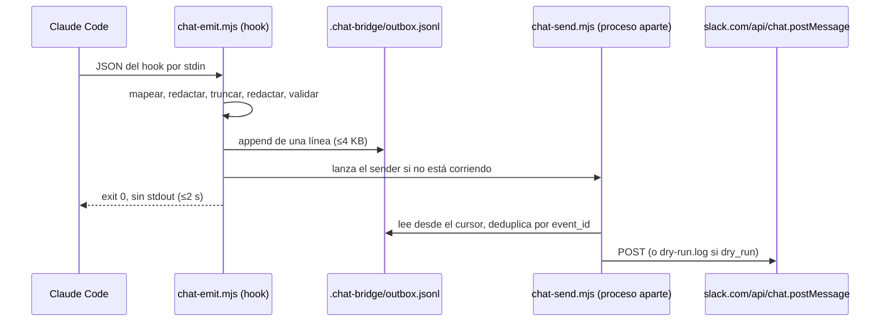

# Team Chat Bridge (`integrations/chat/`)

Publica la actividad del equipo de agentes en un canal de Slack: cada agente aparece con su propio nombre y emoji. Diseño y contrato: [ADR-0003](../../docs/adr/0003-chat-bridge.md) (incluye las enmiendas A1–A12, D15 y D16). Visión: `PRD.md`, Core Feature 6.

> **Apagado por defecto.** Si no configurás nada, los hooks salen en milisegundos y no hacen nada. Aunque lo habilites, arranca en **dry-run**: no envía nada a Slack hasta que lo pidas explícitamente.

## Índice

- [Qué hace (alcance F1)](#qué-hace-alcance-f1)
- [Requisitos](#requisitos)
- [Cómo funciona](#cómo-funciona)
- [Instalación punta a punta](#instalación-punta-a-punta)
- [0. Cablear los hooks en un proyecto nuevo](#0-cablear-los-hooks-en-un-proyecto-nuevo)
- [1. Crear la app de Slack](#1-crear-la-app-de-slack)
- [2. Instalar la app, invitar al bot y obtener los channel IDs](#2-instalar-la-app-invitar-al-bot-y-obtener-los-channel-ids)
- [3. Variables de entorno (`.env`)](#3-variables-de-entorno-env)
- [4. Archivo de configuración (`config/config.json`)](#4-archivo-de-configuración-configconfigjson)
- [5. Habilitar en dry-run y verificar](#5-habilitar-en-dry-run-y-verificar)
- [6. Pasar a live](#6-pasar-a-live)
- [Desactivar y desinstalar](#desactivar-y-desinstalar)
- [Rotar el token](#rotar-el-token)
- [Archivos en `.chat-bridge/`](#archivos-en-chat-bridge)
- [Troubleshooting](#troubleshooting)
- [CI](#ci)
- [Modelo de seguridad](#modelo-de-seguridad)
- [Desarrollo](#desarrollo)
- [Referencias](#referencias)

## Qué hace (alcance F1)

- **Emisor:** hooks de Claude Code (`PreToolUse` con matcher `Agent|Task`, `SubagentStart`, `SubagentStop`, `Stop`). En este repo ya están registrados en `.claude/settings.json`; para otro proyecto hay que cablearlos ([paso 0](#0-cablear-los-hooks-en-un-proyecto-nuevo)).
- **Destino:** Slack, solo salida, a través de `chat.postMessage`. Slack nunca llama al bridge.
- **Eventos publicados** (con la verbosidad `default`):

| Evento | Cuándo | Qué muestra |
|---|---|---|
| `handoff` | un agente delega a otro (`Agent`/`Task`) | `Handoff to <agente>: <título de la tarea>` (redactado). El prompt de la delegación **nunca** se publica. |
| `agent.started` | arranca un subagente | `Started` |
| `agent.finished` | termina un subagente | `Finished (success\|unknown)` más un resumen redactado del reporte |
| `gate.result` | aparece un receipt de `STANDARDS.md` (`REVIEW RECEIPT`, `DoD — <story>`, `SECURITY RECEIPT`) | `<Gate> gate [<story>]: PASS\|FAIL [<veredicto>] (conteos)` |

- **No se publica:** eventos por herramienta, diffs, bloques de código, prompts, valores de `.env` ni secretos.
- **Identidad:** cada agente postea como `<display_name> (agent)` con el `icon_emoji` definido en [`config/identities.json`](config/identities.json). El sufijo ` (agent)` es fijo para que ningún agente pueda hacerse pasar por una persona ni por Slackbot.
- **Fuera de F1:** Discord, emisor OpenCode, hilos, @mentions, avatares como imagen y el gate de release (F2); inbound desde Slack (F3).

Limitaciones conocidas de F1: `agent.started` no muestra quién lo lanzó, no se mide la duración y `outcome` nunca es `error` (ADR A4/A4-c).

## Requisitos

- **Node.js ≥ 22.13** (`engines` en [`package.json`](package.json)). El job de CI corre en Node 24; no hace falta que coincidan, solo que tu `node` cumpla el mínimo.
- **Claude Code** con los hooks de `.claude/settings.json`. Cada hook ejecuta `node "$CLAUDE_PROJECT_DIR/integrations/chat/bin/chat-emit.mjs"` con `timeout: 2`. Por eso el directorio del proyecto donde corre Claude Code tiene que contener `integrations/chat/`. Si solo symlinkeás `.claude/` dentro de otro proyecto, los hooks van a apuntar a un path que no existe.
- **`bin/factory-init` no instala el bridge.** El script symlinkea `agents/`, `commands/`, copia `templates/` y `.env.example`, y nada más. `integrations/chat/` se copia o symlinkea aparte ([paso 0](#0-cablear-los-hooks-en-un-proyecto-nuevo)).
- **Un workspace de Slack** donde puedas instalar apps (permisos de admin o aprobación de un admin).
- **Sin dependencias de runtime.** No hace falta `npm install` para usar el bridge; las devDependencies solo sirven para lint y tests (ver [Desarrollo](#desarrollo)).

## Cómo funciona



- El hook **nunca** hace red, **nunca** escribe en stdout y **siempre** sale con código 0. Si el bridge o Slack fallan, los agentes siguen trabajando igual.
- El sender reintenta errores transitorios con backoff exponencial y manda los definitivos a `dead-letter.jsonl`. Respeta un máximo de 1 mensaje por segundo por canal.
- La entrega es *at-least-once*: muy rara vez puede aparecer un mensaje duplicado.

## Instalación punta a punta

Cada paso trae su comando y su señal de éxito. Los detalles están en las secciones numeradas.

1. **Node ≥ 22.13.**
   ```bash
   node -v
   ```
   Éxito: `v22.13.0` o superior.

2. **Bridge presente en el proyecto.** `factory-init` no lo copia.
   ```bash
   ls integrations/chat/bin/chat-emit.mjs
   ```
   Éxito: imprime el path. Si falla, copiá el directorio (paso 0).

3. **Hooks cableados.** Agregá el bloque de [paso 0](#0-cablear-los-hooks-en-un-proyecto-nuevo) a `.claude/settings.json`.
   ```bash
   grep -c 'chat-emit.mjs' .claude/settings.json
   ```
   Éxito: `4`.

4. **App de Slack creada** con el manifest ([paso 1](#1-crear-la-app-de-slack)).
   ```bash
   # no hay comando: verificá en https://api.slack.com/apps
   ```
   Éxito: la app aparece listada y, en **OAuth & Permissions**, tiene exactamente `chat:write` y `chat:write.customize`.

5. **App instalada en el workspace** ([paso 2](#2-instalar-la-app-invitar-al-bot-y-obtener-los-channel-ids)).
   Éxito: **OAuth & Permissions** muestra un **Bot User OAuth Token** que empieza con `xoxb-`.

6. **Token en `.env`, con permisos correctos.**
   ```bash
   printf 'SLACK_BOT_TOKEN=xoxb-tu-token\n' >> .env
   chmod 600 .env
   stat -c '%a %U' .env
   ```
   Éxito: `600 <tu-usuario>`. Cualquier otra cosa y el bridge ignora el archivo o avisa `env_mode_readable`.

7. **Channel IDs obtenidos y validados** ([paso 2](#2-instalar-la-app-invitar-al-bot-y-obtener-los-channel-ids)).
   ```bash
   ID=C0123ABCDEF   # reemplazá por el tuyo
   [[ "$ID" =~ ^[CDG][A-Z0-9]{8,}$ ]] && echo ok
   ```
   Éxito: `ok`.

8. **Bot invitado a cada canal.**
   ```
   /invite @agent-team-bridge
   ```
   Éxito: Slack confirma que agregó el bot. Sin esto, el envío muere con `not_in_channel`.

9. **`config/config.json` creado y editado** ([paso 4](#4-archivo-de-configuración-configconfigjson)).
   ```bash
   cp integrations/chat/config/config.example.json integrations/chat/config/config.json
   node -e "console.log(JSON.parse(require('node:fs').readFileSync('integrations/chat/config/config.json','utf8')).default_channel)"
   ```
   Éxito: imprime tu channel ID real, no `C0000000000`.

10. **Dry-run habilitado** ([paso 5](#5-habilitar-en-dry-run-y-verificar)). En `.env`: `CHAT_BRIDGE_ENABLED=true` y `CHAT_BRIDGE_DRY_RUN=true`. Reiniciá Claude Code y corré una delegación.
    ```bash
    tail -n 1 .chat-bridge/dry-run.log
    ```
    Éxito: una línea JSON con `at`, `event_id` y `payload`.

11. **Payloads revisados.** Leé `.chat-bridge/dry-run.log` completo y `.chat-bridge/bridge.log`.
    Éxito: el texto es el que querés que vea el canal, el `channel` del payload es el correcto y `bridge.log` no tiene `error`.

12. **Live** ([paso 6](#6-pasar-a-live)). Poné `CHAT_BRIDGE_DRY_RUN=false`, reiniciá Claude Code y dispará un evento.
    ```bash
    tail -n 5 .chat-bridge/dead-letter.jsonl
    ```
    Éxito: el mensaje aparece en Slack en pocos segundos y `dead-letter.jsonl` no suma líneas.

> **Ojo con `.env.example`.** Copiarlo deja el bridge apagado: `CHAT_BRIDGE_ENABLED` y `CHAT_BRIDGE_DRY_RUN` vienen vacías. Escribí `CHAT_BRIDGE_ENABLED=true` a mano y, si querés forzar dry-run, `CHAT_BRIDGE_DRY_RUN=true`; si esa clave queda vacía o no la definís, se usa `dry_run` de `config.json` (default `true`).

## 0. Cablear los hooks en un proyecto nuevo

Los hooks de `.claude/settings.json` de este repo solo aplican a este repo. En otro proyecto hay que agregarlos.

**1. Poné el bridge dentro del proyecto.** Los hooks resuelven el script contra `$CLAUDE_PROJECT_DIR`, así que el proyecto tiene que contener `integrations/chat/`:

```bash
# opción A: copia
mkdir -p integrations && cp -R <factory>/integrations/chat integrations/chat

# opción B: symlink del directorio completo
mkdir -p integrations && ln -s <factory>/integrations/chat integrations/chat
```

**2. Agregá este bloque a `.claude/settings.json` del proyecto.** Es aditivo: si el archivo ya tiene `hooks`, `mcpServers` u otras claves, fusioná sin borrar nada.

```json
{
  "hooks": {
    "PreToolUse": [
      {
        "matcher": "Agent|Task",
        "hooks": [
          {
            "type": "command",
            "command": "node \"$CLAUDE_PROJECT_DIR/integrations/chat/bin/chat-emit.mjs\"",
            "timeout": 2
          }
        ]
      }
    ],
    "SubagentStart": [
      {
        "hooks": [
          {
            "type": "command",
            "command": "node \"$CLAUDE_PROJECT_DIR/integrations/chat/bin/chat-emit.mjs\"",
            "timeout": 2
          }
        ]
      }
    ],
    "SubagentStop": [
      {
        "hooks": [
          {
            "type": "command",
            "command": "node \"$CLAUDE_PROJECT_DIR/integrations/chat/bin/chat-emit.mjs\"",
            "timeout": 2
          }
        ]
      }
    ],
    "Stop": [
      {
        "hooks": [
          {
            "type": "command",
            "command": "node \"$CLAUDE_PROJECT_DIR/integrations/chat/bin/chat-emit.mjs\"",
            "timeout": 2
          }
        ]
      }
    ]
  }
}
```

**3. Verificá y reiniciá Claude Code.**

```bash
grep -c 'chat-emit.mjs' .claude/settings.json   # tiene que dar 4
```

- `matcher: "Agent|Task"` cubre el nombre actual y el viejo de la herramienta de delegación.
- `timeout: 2` es el guard externo de Claude Code; el script tiene además un deadline interno de 1500 ms.
- `node` tiene que estar en el `PATH` de la sesión, con la versión mínima de [Requisitos](#requisitos).
- Si el proyecto no tiene `integrations/chat/`, `node` no arranca el script y el hook no emite nada.
- Symlinkear solo `.claude/` no alcanza: el path del comando se resuelve contra el proyecto, no contra el repo de la factory.

## 1. Crear la app de Slack

La app necesita **solo dos scopes de bot**: `chat:write` y `chat:write.customize`. No usa Socket Mode, Event Subscriptions, interactividad ni slash commands. Tampoco pide `chat:write.public`: al bot se lo invita a cada canal.

### Opción A: desde el manifest (recomendada)

1. Entrá a <https://api.slack.com/apps> → **Create New App** → **From a manifest**.
2. Elegí el workspace.
3. Pegá el contenido de [`slack/manifest.yml`](slack/manifest.yml) (pestaña YAML) y confirmá con **Create**.

### Opción B: manual

1. <https://api.slack.com/apps> → **Create New App** → **From scratch**. Poné un nombre (por ejemplo `Agent Team Bridge`) y elegí el workspace.
2. **OAuth & Permissions** → **Scopes** → **Bot Token Scopes**: agregá **solo** `chat:write` y `chat:write.customize`.
3. No actives **Socket Mode**, **Event Subscriptions**, **Interactivity & Shortcuts** ni **Slash Commands**.
4. Dejá vacíos los **User Token Scopes**.

> No agregues otros scopes. F1 no los usa, y ampliarlos requiere una enmienda del ADR (D14). El inbound (F3) va a usar una app y un token distintos.

## 2. Instalar la app, invitar al bot y obtener los channel IDs

1. **Instalar:** en la app, **OAuth & Permissions** (o **Install App**) → **Install to Workspace** → **Allow**.
2. **Copiar el token:** copiá el **Bot User OAuth Token**, que empieza con `xoxb-`. Va únicamente en `.env` (paso 3). No lo pegues en ningún otro archivo, issue ni chat.
3. **Elegir el canal:** usá un canal **privado** con membresía restringida (ver [Modelo de seguridad](#modelo-de-seguridad)).
4. **Invitar al bot** en cada canal donde vaya a postear. Escribí en el canal:
   ```
   /invite @agent-team-bridge
   ```
   (usá el nombre que le diste al bot). Sin este paso, Slack responde `not_in_channel`.
5. **Obtener el channel ID:** abrí el canal → clic en su nombre → pestaña **About**/**Acerca de** → al final aparece **Channel ID** (por ejemplo `C0123ABCDEF`). Otra forma: clic derecho sobre el canal → **Copy link**; el ID es el último segmento de la URL.
   - El ID tiene que cumplir `^[CDG][A-Z0-9]{8,}$`. El bridge **no** acepta nombres como `#equipo`, ni IDs de usuario (`U0123ABCDEF`) ni de conversación directa.
   - Repetí el paso 4 en cada canal que uses: `default_channel` y cada entrada de `channels`.

## 3. Variables de entorno (`.env`)

El bridge lee **exactamente un archivo**, `<proyecto>/.env`, donde `<proyecto>` es `CLAUDE_PROJECT_DIR`. Del archivo toma solo las claves de la tabla; cualquier otra se descarta sin leerla.

| Clave | Quién la lee | Valores válidos | Para qué sirve |
|---|---|---|---|
| `CHAT_BRIDGE_ENABLED` | hook y sender | `true` o `false`, exactos | Tiene que valer `true` para que el bridge haga algo. |
| `CHAT_BRIDGE_DRY_RUN` | hook y sender | `true` o `false`, exactos | Pisa a `dry_run` del config. `false` envía a Slack; `true` fuerza dry-run. |
| `CHAT_BRIDGE_CONFIG` | hook y sender | path de hasta 1024 caracteres | Config alternativo. Un path relativo se resuelve contra el directorio del proyecto. Default: `integrations/chat/config/config.json`. |
| `CHAT_BRIDGE_SPOOL_DIR` | hook y sender | path **absoluto** | Directorio del spool. Default: `<proyecto>/.chat-bridge/`. Conviene dejarlo dentro del proyecto. |
| `SLACK_BOT_TOKEN` | solo el sender | `xoxb-…` (`^xoxb-[A-Za-z0-9-]{10,250}$`) | Token del bot. El hook nunca lo carga. |
| `CHAT_BRIDGE_CHANNEL_*` (5 claves) | solo el sender | `^[CDG][A-Z0-9]{8,}$` | Canales por `.env`. Ver [Canales por `.env`](#canales-por-env-enmienda-a12). |

Si una clave tiene un valor inválido, se ignora y `bridge.log` registra `env_bad_value:<CLAVE>` (solo el nombre, nunca el valor). Una clave vacía (`CHAT_BRIDGE_DRY_RUN=`) cuenta como inválida: es inofensivo, pero genera ese warning.

### Canales por `.env` (enmienda A12)

Firmado como A12 en las [enmiendas del ADR-0003](../../docs/adr/0003-chat-bridge.md#amendments). Permite fijar los canales sin editar `config.json`.

| Clave | Campo que pisa |
|---|---|
| `CHAT_BRIDGE_CHANNEL_DEFAULT` | `settings.default_channel` |
| `CHAT_BRIDGE_CHANNEL_HANDOFF` | `settings.channels['handoff']` |
| `CHAT_BRIDGE_CHANNEL_AGENT_STARTED` | `settings.channels['agent.started']` |
| `CHAT_BRIDGE_CHANNEL_AGENT_FINISHED` | `settings.channels['agent.finished']` |
| `CHAT_BRIDGE_CHANNEL_GATE_RESULT` | `settings.channels['gate.result']` |

Reglas:

- **Validación:** la misma que `config.json`, `^[CDG][A-Z0-9]{8,}$`. Un nombre (`#equipo`), un ID de usuario (`U0123ABCDEF`) o un ID de DM no pasan.
- **Precedencia:** variable de proceso > `.env` > `config.json`. Una clave ausente en `.env` deja el valor de `config.json` intacto.
- **Valor inválido:** se descarta **solo esa clave**, `bridge.log` registra `warn env_bad_value:<CLAVE>` y el bridge sigue con el valor de `config.json`. No es fatal.
- **Dónde se aplica:** las lee el **sender**, después de validar `config.json`. El hook no las lee: el ruteo no ocurre en el hook. `default_channel` sigue siendo obligatorio en `config.json` y el schema no cambia (`version: 1`).
- **Granularidad:** solo por **tipo de evento**. No existe ruteo por agente, ni por sesión, ni por story. Eso es la opción B del ADR, fuera de alcance: no la implementes sin una enmienda nueva.
- **Estado:** contrato firmado. Si tu copia del sender todavía no aplica estas claves, configurá los canales en `config.json` ([paso 4](#4-archivo-de-configuración-configconfigjson)).

### Permisos del archivo: `chmod 600` obligatorio

```bash
chmod 600 .env
```

- Si el grupo u otros usuarios pueden **escribir** el archivo (`mode & 022`), el bridge lo ignora completo (`env_bad_mode`) y queda apagado.
- Si pueden **leerlo** (`mode & 044`), lo usa pero registra `env_mode_readable`. Es lo que pasa con el `0644` por defecto, y deja el token de Slack (y las credenciales de Jira, etc.) legibles para cualquier usuario local. Corrigelo con `chmod 600`. Si la máquina es o fue multiusuario, rotá las credenciales.
- Además, el archivo debe ser tuyo (`env_bad_owner`), regular y no un symlink (`env_not_regular`), y pesar como máximo 16 KiB (`env_too_large`).

**Nunca commitees `.env`.** Ya está en `.gitignore`; `.env.example` solo tiene placeholders vacíos.

### Precedencia

1. **Variable exportada en el proceso** (shell, direnv): gana siempre que esté definida, aunque esté **vacía**.
2. **`.env`**: completa solo las claves que el proceso no trae.
3. **`config.json`**: solo para `dry_run` y para los canales. `CHAT_BRIDGE_DRY_RUN` y las `CHAT_BRIDGE_CHANNEL_*` los pisan en los dos sentidos.

> **Ojo con direnv:** si `.env` tiene `CHAT_BRIDGE_ENABLED=` (vacío) y direnv lo exporta, el proceso trae `CHAT_BRIDGE_ENABLED=""`. Eso está definido y no es `"true"`, así que el hook sale sin hacer nada, aunque después cambies el archivo y no recargues direnv. Para habilitar, escribí `CHAT_BRIDGE_ENABLED=true` y recargá el entorno (`direnv reload`), o reiniciá Claude Code desde una shell que no exporte la variable.

## 4. Archivo de configuración (`config/config.json`)

`config.json` es **local y está gitignoreado** (`integrations/chat/.gitignore`), porque tiene IDs de canales de tu workspace. La plantilla que sí se versiona es `config/config.example.json`:

```bash
cp integrations/chat/config/config.example.json integrations/chat/config/config.json
```

Si `config.json` no existe, el bridge **no** usa la plantilla como fallback: no publica nada y `bridge.log` registra `config_unreadable`.

Ejemplo mínimo:

```json
{
  "version": 1,
  "provider": "slack",
  "dry_run": true,
  "verbosity": "default",
  "default_channel": "C0123ABCDEF",
  "channels": { "gate.result": "C0456GHIJKL" },
  "redaction": { "max_summary_chars": 500, "extra_patterns": [] }
}
```

Referencia de campos. La autoridad es [`schema/config.v1.schema.json`](schema/config.v1.schema.json), y el loader rechaza claves desconocidas.

| Campo | Default | Regla |
|---|---|---|
| `version` | — | `1` (requerido) |
| `provider` | — | `"slack"` (requerido) |
| `default_channel` | — | channel ID (requerido). Recibe todo lo que no esté en `channels`. |
| `channels` | `{}` | Mapa de tipo de evento a channel ID. Claves posibles: `handoff`, `agent.started`, `agent.finished`, `gate.result`. |
| `dry_run` | `true` | `false` para enviar a Slack (ver [paso 6](#6-pasar-a-live)). |
| `verbosity` | `"default"` | `minimal`: solo `gate.result`. `default`: handoffs, inicio/fin y gates. `verbose`: además un `agent.finished` del PM en cada turno (ruidoso). Ninguna publica eventos por herramienta. |
| `redaction.max_summary_chars` | `500` | 0–2000. **`0` = solo metadatos**: se envían tipo, agente y destino, sin resumen. |
| `redaction.max_lines` | `8` | 0–50 líneas de resumen (`0` = sin límite de líneas; el de caracteres sigue aplicando). |
| `redaction.max_task_title_chars` | `120` | 0–200. Con `0` el handoff no lleva título. |
| `redaction.strip_code_blocks`, `strip_diffs`, `mask_home_paths` | `true` | Solo pueden valer `true`; no se pueden desactivar en F1. |
| `redaction.extra_patterns` | `[]` | Regex propias, ver abajo. |
| `delivery.timeout_ms` | `5000` | 100–30000 |
| `delivery.max_attempts` | `5` | 1–10 |
| `delivery.per_channel_rate_per_sec` | `1` | mayor que 0 y hasta 1 |
| `spool.dir` | `".chat-bridge"` | Relativo al proyecto, sin `..`. Para un path absoluto usá `CHAT_BRIDGE_SPOOL_DIR`. |
| `spool.max_bytes` | `5242880` | 64 KiB–50 MiB |
| `spool.dead_letter_ttl_days` | `7` | 1–90 |

Al cargar, `config.json` e `identities.json` se escanean en busca de patrones de token. Si encuentra uno, el bridge no arranca (`config_contains_secret` / `identities_contains_secret`).

> Los canales también se pueden fijar por `.env` y pisan a los del JSON ([Canales por `.env`](#canales-por-env-enmienda-a12)). `default_channel` sigue siendo obligatorio acá.

### `extra_patterns`: regex de redacción propias

Cada entrada es el **source** de una regex (sin `/…/` ni flags) que se agrega a las reglas internas; los matches se reemplazan por `[REDACTED:custom]`. Solo pueden hacer la redacción más estricta. Para evitar ReDoS, el loader rechaza el config completo (`config_invalid` con `config_detail redaction.extra_patterns: invalid pattern`) si un patrón:

- mide más de 200 caracteres, o hay más de 50 patrones;
- usa backreferences (`\1`, `\k<…>`) o lookarounds (`(?=`, `(?!`, `(?<=`, `(?<!`);
- tiene un grupo cuantificado que contiene otro cuantificador o una alternancia (`(a+)+`, `(a|aa)+`);
- supera el presupuesto de backtracking. Cada `*`, `+` o `{n,}` cuenta 256, `?` cuenta 2 y `{n,m}` cuenta `m-n+1`; el producto tiene que ser ≤ 256 por patrón y la suma ≤ 1024 entre todos. Por eso un patrón admite **un solo** cuantificador sin límite, y solo si no hay otro cuantificador variable: `\w{1,16}@[a-z]+` cuesta 16 × 256 = 4096 y también se rechaza.

| Rechazado | Usar en su lugar |
|---|---|
| `\w+@\w+` | `\w{1,16}@[a-z]{1,16}` (costo 16 × 16 = 256) |
| `.*secret.*` | `secret` |
| `(a+)+` | `a+` |
| `\d+\d+` | `\d{2,32}` |

Ejemplos válidos: `INTERNAL-[0-9]+`, `[A-Z]{3}-[0-9]+` (`{3}` cuenta 1), `[a-z]{1,16}@[a-z]{1,16}`.

Las reglas propias se aplican línea por línea, en segmentos de 256 caracteres. En una línea más larga, un match que cruce el borde de un segmento no se enmascara; las reglas internas sí se aplican sobre el texto completo.

## 5. Habilitar en dry-run y verificar

1. Completá `.env`, con `chmod 600`:
   ```bash
   CHAT_BRIDGE_ENABLED=true
   CHAT_BRIDGE_DRY_RUN=true
   SLACK_BOT_TOKEN=xoxb-...
   ```
2. Asegurate de que `integrations/chat/config/config.json` exista y tenga tus channel IDs (paso 4).
3. Reiniciá Claude Code para que tome el entorno, y corré una delegación cualquiera (por ejemplo `/pm`).
4. Revisá lo que **se habría** enviado. Cada línea es `{at, event_id, payload}` con el body exacto de `chat.postMessage`:
   ```bash
   tail -n 5 .chat-bridge/dry-run.log
   cat .chat-bridge/bridge.log
   ```
   `dry-run.log` tiene modo `0600` y nunca se escribe en stdout. Revisalo antes de pasar a live: es lo que va a ver todo el canal.

Prueba manual sin Claude Code (desde la raíz del proyecto):

```bash
echo '{"hook_event_name":"SubagentStart","session_id":"smoke-1","agent_id":"smoke-a1","agent_type":"qa"}' \
  | CLAUDE_PROJECT_DIR="$PWD" node integrations/chat/bin/chat-emit.mjs
sleep 3; tail -n 1 .chat-bridge/dry-run.log
```

El `event_id` es determinístico (sale de `session_id` + `agent_id`), así que repetir el mismo JSON no genera un evento nuevo. Para otra prueba, cambiá `agent_id`.

## 6. Pasar a live

1. Revisá `dry-run.log` (paso 5).
2. Poné `CHAT_BRIDGE_DRY_RUN=false` en `.env`, o `"dry_run": false` en `config.json` sin `CHAT_BRIDGE_DRY_RUN` definida. Si `CHAT_BRIDGE_DRY_RUN=true` está definida, gana y el bridge sigue en dry-run.
3. Verificá que `SLACK_BOT_TOKEN` esté en `.env` o exportado. En live, sin token, el sender no arranca (`sender_refused missing_token`).
4. Disparás un evento y tiene que aparecer en Slack en unos pocos segundos.

> **Los eventos de dry-run no se reenvían (ADR A7).** Un "envío" en dry-run queda en `ledger.jsonl` con `provider: "dry-run"`. Al pasar a live, esos eventos **no** se publican: no se vuelca historia vieja al canal, y el ledger deduplica por `event_id` sin importar el proveedor. Para que un evento ya previsualizado pueda publicarse en live (por ejemplo, un receipt que vuelve a detectarse en la misma sesión), borrá el spool cuando no haya un sender corriendo (no existe `.chat-bridge/sender.lock`):
> ```bash
> rm -rf .chat-bridge/
> ```
> Se recrea solo, con permisos `0700`/`0600`, en el próximo hook. Lo ya drenado no se reconstruye: solo se publican los eventos que se emitan desde ese momento.

## Desactivar y desinstalar

Tres niveles independientes. Ninguno borra archivos por sí solo.

| Acción | Efecto | Qué queda |
|---|---|---|
| `CHAT_BRIDGE_ENABLED=false` en `.env` (o borrar la clave) | El hook sale antes de leer el config y el sender no drena (`disabled`). Deja de emitirse todo. | `.chat-bridge/`, `config.json` y el token, intactos. Volver a `true` lo reactiva. |
| Quitar los 4 hooks de `.claude/settings.json` | Claude Code deja de invocar el bridge. | Todo lo demás intacto; el bridge no se entera de ningún evento. |
| `rm -rf .chat-bridge/` | Borra spool, cursor, ledger, dead-letter y logs. | Se recrea vacío en el próximo hook. Se pierde el historial de dry-run y la deduplicación previa. |
| Borrar `integrations/chat/` | Desinstala el código. | Los hooks quedan apuntando a un path inexistente: quitarlos **antes**. |
| Revocar el token o desinstalar la app en Slack | Corta el acceso al workspace. | `.env` conserva el token viejo: borralo. |

Orden recomendado para una desinstalación completa:

1. Poné `CHAT_BRIDGE_ENABLED=false` y esperá a que no haya un sender corriendo (`ls .chat-bridge/sender.lock` no existe).
2. Quitá el bloque `hooks` del bridge en `.claude/settings.json` y reiniciá Claude Code.
3. Borrá `.chat-bridge/`.
4. Borrá `SLACK_BOT_TOKEN` (y las `CHAT_BRIDGE_*`) de `.env`.
5. Revocá el token en la app de Slack, o desinstalá la app.
6. Si querés, borrá `integrations/chat/` y `config/config.json`.

Detalles:

- **Borrar la clave no siempre alcanza.** Si `CHAT_BRIDGE_ENABLED=true` está exportada en el proceso (direnv, shell), gana sobre `.env`. Revisá con `env | grep CHAT_BRIDGE`.
- **Desactivar no borra historia.** Los eventos ya encolados en el spool se drenan la próxima vez que corra el sender con el bridge habilitado; si querés descartarlos, borrá `.chat-bridge/`.
- **No borres `.claude/settings.json` completo.** Ahí viven los MCP servers y otras claves; sacá solo las entradas con `chat-emit.mjs`.

## Rotar el token

1. **Revocá el token viejo.** En la app de Slack: **OAuth & Permissions** → revocá el token, o reinstalá la app (el anterior queda inválido).
2. **Copiá el nuevo Bot User OAuth Token** (`xoxb-…`).
3. **Actualizá `.env`** y volvé a aplicar permisos:
   ```bash
   # editá SLACK_BOT_TOKEN en .env
   chmod 600 .env
   stat -c '%a %U' .env   # 600 <tu-usuario>
   ```
4. **Verificá el pipeline en dry-run.** En dry-run el sender no usa el token, así que este paso valida el resto (config, spool, redacción), no la credencial:
   ```bash
   CHAT_BRIDGE_DRY_RUN=true   # en .env
   # una delegación, y después:
   tail -n 1 .chat-bridge/dry-run.log
   ```
5. **Probá en live.** Poné `CHAT_BRIDGE_DRY_RUN=false`, reiniciá Claude Code y dispará un evento. Éxito: el mensaje aparece en Slack y `dead-letter.jsonl` no suma líneas.
6. **Si el token viejo sigue en uso:** Slack responde `invalid_auth` (o `token_revoked`), el evento va a `dead-letter.jsonl` con `reason: non_retryable` y **no se reintenta solo**:
   ```bash
   tail -n 5 .chat-bridge/dead-letter.jsonl
   ```
   Corregí `.env` y reemití el evento. Los eventos que ya cayeron en dead-letter no se reenvían.

Reinstalar la app también puede cambiar el token sin que lo pidas: si el bridge empieza a fallar con `invalid_auth` después de tocar la app, repetí este procedimiento.

## Archivos en `.chat-bridge/`

Directorio `0700`, archivos `0600`. Está en `.gitignore`. El bridge rechaza symlinks.

| Archivo | Contenido |
|---|---|
| `outbox.jsonl` | Spool de eventos ya redactados (un JSON por línea, ≤4 KB). Se rota tras drenarse. |
| `cursor.json` | Posición de lectura del sender. |
| `ledger.jsonl` | Eventos enviados (`event_id`, proveedor, canal, `ts`). Se usa para deduplicar; se poda a 30 días. |
| `dead-letter.jsonl` | Eventos que no se pudieron enviar: `reason`, `error_code`, `attempts`. TTL de 7 días por defecto. |
| `sender.lock` | `{pid, started_at}` mientras corre el sender. |
| `bridge.log` | Diagnóstico. Solo códigos de razón, nunca valores ni secretos. Se trunca al pasar 1 MiB. |
| `dry-run.log` | Payloads renderizados en dry-run. |

## Troubleshooting

Casi todo el diagnóstico está en `.chat-bridge/bridge.log`. El formato de cada línea es `<timestamp ISO> <nivel> <código> [detalle]`:

```bash
tail -n 50 .chat-bridge/bridge.log
tail -n 5  .chat-bridge/dead-letter.jsonl
```

### No aparece nada (ni `.chat-bridge/`, ni `bridge.log`)

- El hook resolvió `CHAT_BRIDGE_ENABLED` distinto de `"true"`. En ese caso sale **sin escribir log**. Revisá:
  - que `.env` tenga `CHAT_BRIDGE_ENABLED=true` exacto;
  - que no haya una variable exportada vacía o en `false` que gane (ver [Precedencia](#precedencia)): `env | grep CHAT_BRIDGE`;
  - que `.env` no esté siendo ignorado por permisos. Con `env_bad_mode`, `env_bad_owner`, `env_not_regular` o `env_too_large` el archivo se descarta completo, el bridge queda apagado y **no deja log**. Verificá con `stat -c '%a %U' .env`: tiene que dar `600 <tu usuario>`.
- Claude Code no está cargando los hooks, o el proyecto no contiene `integrations/chat/` (ver [Requisitos](#requisitos) y [paso 0](#0-cablear-los-hooks-en-un-proyecto-nuevo)). Verificá con `grep -c 'chat-emit.mjs' .claude/settings.json`: tiene que dar `4`.
- El spool dir fue rechazado. Ver `spool_parent_world_writable` más abajo.

### Errores de Slack (en `dead_letter <código> status=<http> attempts=<n>`)

| Código | Causa | Solución |
|---|---|---|
| `not_in_channel` | El bot no es miembro del canal. | `/invite @<bot>` en ese canal. |
| `channel_not_found` | El ID no existe, es de otro workspace o es un canal privado sin el bot. | Revisá el channel ID (paso 2) e invitá al bot. |
| `invalid_auth`, `not_authed`, `token_revoked`, `account_inactive` | Token inválido, revocado o de otra app. | Copiá de nuevo el **Bot User OAuth Token** (`xoxb-`) en `.env`. Si reinstalaste la app, el token cambió. Ver [Rotar el token](#rotar-el-token). |
| `missing_scope` | Faltan `chat:write` o `chat:write.customize`. | Agregá los scopes y reinstalá la app. |
| `is_archived` | Canal archivado. | Usá otro canal. |
| `ratelimited` / HTTP 429 | Límite de Slack. | Es automático: el sender respeta `Retry-After` y reintenta con backoff. Solo pasa a dead-letter (`reason: max_attempts`) si se agota `delivery.max_attempts`. Si se repite, subí `verbosity` a `minimal` o separá canales. |
| `timeout`, `network_error`, `http_5xx` | Red o Slack caído. | Se reintenta solo; los eventos sobreviven en el spool. |

Estos errores no son reintentables: el evento va directo a dead-letter y **no se reenvía solo**.

### Config

| Línea en `bridge.log` | Significado |
|---|---|
| `error config_unreadable` | No existe `config/config.json` (o el path de `CHAT_BRIDGE_CONFIG`). Copiá la plantilla (paso 4). |
| `error config_not_json` / `config_too_large` | JSON inválido o archivo de más de 64 KiB. |
| `error config_contains_secret` | El config tiene algo con forma de token. Sacalo: los secretos van solo en `.env`. |
| `error config_invalid` seguido de `error config_detail <campo>: <regla>` | Validación fallida. Cada `config_detail` indica el campo y la regla (por ejemplo `default_channel: invalid channel id`, `redaction.strip_diffs: must be true`, `redaction.extra_patterns: invalid pattern`). Se listan hasta 10 y después `N more`. |
| `error identities_invalid` + `config_detail …` | `identities.json` modificado de forma inválida. |
| `error sender_refused <código>` | El sender no arrancó por ese motivo (`config_invalid`, `missing_token`, etc.). |

Con el config inválido, el hook no encola nada y sale con 0; los agentes no se enteran.

### `.env` (códigos `env_*`)

| Código | Significado |
|---|---|
| `env_mode_readable` (warn) | `.env` legible por grupo u otros. Se usa igual. Corregí con `chmod 600 .env`. |
| `env_bad_mode` | Escribible por grupo u otros: se ignora todo el archivo. |
| `env_bad_owner` | El archivo no es del usuario actual: se ignora. |
| `env_not_regular` | Es un symlink o no es un archivo regular: se ignora. |
| `env_too_large` | Pesa más de 16 KiB: se ignora. |
| `env_changed` | El archivo cambió entre el chequeo y la lectura: se ignora en ese hook. |
| `env_parse_error` / `env_unreadable` / `env_load_failed` | No se pudo leer o parsear: se ignora. |
| `env_bad_value:<CLAVE>` | Valor inválido para esa clave (ver la tabla del paso 3). Solo se ignora esa clave. |
| `env_bad_value:CHAT_BRIDGE_CHANNEL_*` (warn) | Canal con formato inválido: un ID de usuario (`U0123ABCDEF`) en vez de canal, un nombre (`#equipo`) o un ID de DM. Se ignora esa clave y sigue el valor de `config.json`. Lo escribe el **sender**, no el hook. |
| `env_absent` (debug) | No hay `.env`. No es un error: se usa solo el entorno del proceso. |
| `env_no_project_dir` (debug) | No hay un `CLAUDE_PROJECT_DIR` absoluto, así que no se carga ningún `.env`. |

### `no_project_dir`

`info no_project_dir`: el hook corrió sin un `CLAUDE_PROJECT_DIR` absoluto (típico al probarlo a mano). El bridge **nunca** usa el `cwd` del payload como fuente de `.env`. Sin project dir no carga `.env`, y el spool y el config se resuelven contra el directorio actual. Exportá `CLAUDE_PROJECT_DIR="$PWD"` para probar.

### `spool_parent_world_writable` (y `spool_dir_unsafe`, `spool_dir_bad_owner`)

El bridge rechaza el spool dir si:
- `spool_parent_world_writable`: su directorio padre (resuelto con `realpath`) es escribible por todos y no tiene sticky bit;
- `spool_dir_unsafe`: es un symlink o no es un directorio;
- `spool_dir_bad_owner`: pertenece a otro usuario.

Como `bridge.log` vive dentro del spool dir, estos errores **no llegan a escribirse**. El síntoma es que no se crea ni se actualiza nada en `.chat-bridge/`. Revisá con `stat -c '%a %U' "$(dirname <spool>)"`. Solución: dejá el spool dentro del proyecto (el default) y no lo pongas bajo un directorio `777` sin sticky bit. Un proyecto alcanzado por symlink está permitido; un spool dir que sea symlink, no.

### Limitaciones conocidas (deuda F1)

Hay dos fallas que **no dejan rastro en `bridge.log`**. Están registradas como deuda de F1:

- **Spool dir rechazado** (`spool_parent_world_writable`, `spool_dir_unsafe`, `spool_dir_bad_owner`): el log vive dentro del directorio rechazado, así que no se puede escribir. Síntoma: `.chat-bridge/` no se crea o no cambia. Diagnóstico: `stat -c '%a %U' <spool> "$(dirname <spool>)"`.
- **`.env` rechazado cuando `CHAT_BRIDGE_ENABLED=true` está solo en `.env`** (`env_bad_mode`, `env_bad_owner`, `env_not_regular`, `env_too_large`, etc.): el bridge queda deshabilitado, y los códigos `env_*` solo se escriben cuando el bridge está habilitado. Síntoma: no aparece nada. Diagnóstico: `stat -c '%a %U' .env` tiene que dar `600 <tu usuario>`.

### Otros

- `info gate_relayed:<gate>`: se detectó un receipt fuera de su agente dueño. Se publica como "Relayed (unverified)" (ver abajo).
- `warn dead_letter <motivo>` sin código de Slack (por ejemplo `rotation_leftover`, línea inválida): una línea del spool no se pudo procesar y quedó en `dead-letter.jsonl`.
- `warn sent_unknown invalid_response status=200`: Slack respondió 2xx con un body ilegible. El mensaje probablemente se publicó y no se reintenta para no duplicarlo.

## CI

El job `chat-bridge` de [`.github/workflows/ci.yml`](../../.github/workflows/ci.yml) es el gate del paquete. Corre en **Node 24** (Active LTS) con `working-directory: integrations/chat`:

```bash
npm ci
npm run lint
npm run test:coverage   # node:test, umbral ≥80% de líneas y branches
npm audit --audit-level=high
```

- **Es solo test: no publica en Slack.** No necesita `SLACK_BOT_TOKEN` ni acceso a red; los tests inyectan `fetch` y usan un spool temporal por test.
- Sube `integrations/chat/coverage/lcov.info` como artefacto (7 días).
- El job `secret-scan` (gitleaks) del mismo workflow cubre todo el repo, incluido `integrations/chat/`.
- El workflow lo declara como check requerido (`chat-bridge`). Si lo configurás en branch protection, verificá el nombre exacto del check en la lista del PR: el nombre visible del job es `Chat Bridge (lint, test+coverage, audit)`.

Para reproducirlo local:

```bash
cd integrations/chat && npm ci && npm run lint && npm run test:coverage
```

## Modelo de seguridad

Qué garantiza el bridge en F1 (detalle en ADR-0003 D7/D15 y en el [security gate](../../docs/security/2026-11-11-chat-bridge-f1.md)):

- **El token** vive solo en `.env` (`0600`) o en el entorno del sender. Nunca va en argv, spool, logs, errores ni config, y el hook nunca lo carga.
- **Red:** solo `https://slack.com/api/chat.postMessage`, con `redirect: "error"` y timeout. No hay incoming webhooks.
- **Redacción doble** (en el hook y en el sender), que falla cerrada. Quita bloques de código y diffs; enmascara tokens conocidos, claves `key=value`, `Bearer`/`Basic`, claves privadas, credenciales en URLs, cadenas de alta entropía y rutas `/home/<usuario>`; elimina caracteres invisibles y de control bidireccional.
- **Higiene de Slack:** escapa `&`, `<` y `>`, así que `<!channel>`, `<!here>`, `<@U…>` y los links disfrazados no funcionan. Además usa `link_names: false` y sin unfurl.
- **Hooks no bloqueantes:** ≤2 s, exit 0 y cero bytes en stdout, así que el bridge no puede alterar decisiones de Claude Code.

### Riesgos residuales (aceptados para F1)

1. **Los resúmenes son salida de un LLM.** Pueden traer contenido de archivos no confiables o de un prompt injection, y la redacción por patrones no detecta un secreto parafraseado (por ejemplo, deletreado en palabras). Si no podés aceptarlo, usá `"max_summary_chars": 0` (solo metadatos) y, si querés, `"max_task_title_chars": 0`.
2. **Las URLs sueltas son clickeables.** Slack linkifica `https://…` aunque el unfurl esté apagado, así que un agente manipulado podría publicar un link de phishing bajo un nombre de agente confiable. No hagas clic en links de mensajes del bridge sin verificarlos. Antes de F3 se va a agregar defang o allowlist de dominios (ADR A10).
3. **Visibilidad del canal.** Todo lo publicado (títulos de stories, resúmenes, nombres de agentes) lo ve **todo el canal**. Usá un canal **privado** con membresía restringida; en un canal público lo ve todo el workspace.
4. **Los mensajes del chat son informativos, no autoritativos.** El estado real de un gate es el **receipt archivado**: `docs/reviews/YYYY-MM-DD-<scope>.md` (review) y `docs/security/YYYY-MM-DD-<scope>.md` (security), según ADR A9. Ninguna decisión de merge o release debe tomarse a partir de Slack.
5. **"Relayed (unverified)".** Un resultado de gate se atribuye al agente dueño (Reviewer para review, QA para DoD, Security para security) **solo** si el receipt sale del `SubagentStop` de ese mismo agente. Si aparece en otro lado (el PM citándolo en su turno, u otro agente que lo incluye en su reporte), se publica con la identidad de quien lo emitió y con el prefijo `Relayed (unverified):`. Así nadie puede postear un "PASS" con la identidad de Security. Tratá estos mensajes como un rumor y verificá el receipt archivado.

### Buenas prácticas

- `chmod 600 .env`, y nunca commitear `.env` ni `config/config.json`.
- Mantener `dry_run: true` hasta revisar `dry-run.log`.
- Dejar el spool dentro del proyecto (el default).
- Si el token se filtra: en la app de Slack, **OAuth & Permissions** → revocá el token y reinstalá la app ([Rotar el token](#rotar-el-token)).

## Desarrollo

```bash
cd integrations/chat
npm ci
npm run lint
npm test            # node:test con cobertura mínima de 80% en líneas y branches
```

Las devDependencies (`eslint`, `ajv`) son solo para lint y tests; el runtime no tiene dependencias. El plan de tests está en [`docs/test-plan.md`](docs/test-plan.md), y los contratos en `schema/` (`event.v1`, `config.v1`, `identities.v1`).

## Referencias

- [ADR-0003: Team Chat Bridge](../../docs/adr/0003-chat-bridge.md)
- [Security gate F1](../../docs/security/2026-11-11-chat-bridge-f1.md)
- [Review F1](../../docs/reviews/2026-11-11-chat-bridge-f1.md)
- `PRD.md`, Core Feature 6 y criterios de éxito 7–12
